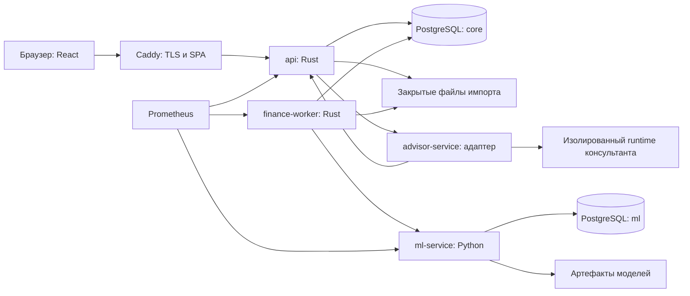

# ЦИ1. Архитектура сервиса финансового прогнозирования

Статус: проектное решение для хакатона. Это спецификация будущей системы, а не отчёт о реализованном продукте. Нагрузочные показатели ниже являются целями для проверки.

## 1. Что строим

Сервис принимает банковскую выписку, разбирает операции и показывает остаток денег по дням минимум на 30 дней вперёд. В прогноз входят регулярные платежи, ожидаемые поступления, счета и обязательства, которых пока нет в выписке. Предприниматель видит дату возможного кассового разрыва, размер дефицита, оценку вероятности и причины.

Дополнительно делаем сценарии «что если», план-факт и ИИ-консультанта. Консультант объясняет результаты и помогает собрать сценарий, но не рассчитывает финансовые показатели самостоятельно.

Исходные данные по ТЗ: синтетические выписки компаний разных отраслей за 1,5-2 года. Сам датасет пока не изучен. Формат файлов, объём, качество разметки и доступность дополнительных источников нужно проверить после получения.

Основные допущения:

- Прогнозируем ликвидность, а не прибыль и не бухгалтерский баланс.
- Начинаем с RUB и одного расчётного контура компании. Несколько счетов поддерживаем через явное объединение; внутренние переводы не считаем выручкой или расходом бизнеса.
- Дата операции и дата ожидаемого платежа являются календарными датами бизнеса. Технические timestamps храним в UTC. Часовой пояс компании обязателен.
- Пользователь может работать с несколькими компаниями. Данные изолированы по `tenant_id` и `company_id`.
- Первый стенд работает на одной VM. Микросервисы разделяют процессы и права, но одна VM и один PostgreSQL остаются общими точками отказа. Высокую доступность не заявляем.
- Нет автоплатежей, выдачи кредитов и подключения к реальным банковским кабинетам. Импорт файлов и адаптеры источников закрывают демонстрационный контур.

## 2. Основные решения

Берём монорепозиторий, микросервисы с HTTP/JSON-контрактами, PostgreSQL, React и Python для ML. Rust используем для публичного API, финансовой логики и фоновых задач.

Не добавляем Kubernetes, Kafka, Redis и отдельный сервис на каждую сущность. Они пока не решают подтверждённую проблему. Самая дорогая часть проекта уже есть: корректная интеграция данных, модели и финансового расчёта.

Долгие операции выполняем через надёжные задания в PostgreSQL. Прогнозы версионируем и сохраняем как неизменяемые результаты. Любой график можно связать с конкретными входными данными и версией модели.

### 2.1. Стек и причины выбора

| Область | Выбор | Почему |
| --- | --- | --- |
| Публичный API и финансовое ядро | Rust, Tokio, Axum, Tower, Serde | Один типизированный контур для прав, импорта, денег и сценариев. Axum не требует отдельного тяжёлого runtime поверх Tokio |
| БД из Rust | SQLx, PostgreSQL | Явные SQL-запросы, транзакции, контроль запросов с tenant-фильтрами. SQLx metadata проверяем в CI, если используем compile-time macros |
| Денежные расчёты | Целые копейки, `rust_decimal` на границах преобразования | Исключаем ошибки двоичной арифметики при хранении и суммировании |
| ML | Python, FastAPI, Pydantic, uv | Python нужен для экспериментов и библиотек; FastAPI задаёт проверяемый внутренний контракт |
| Обработка и модели | pandas, NumPy, scikit-learn; CatBoost как кандидат после baseline | Для табличных временных признаков не нужна нейросеть с нуля. CatBoost добавляем только после честного сравнения |
| Frontend | React, TypeScript, Vite | SPA без ненужного серверного рендеринга и второго backend на Node.js |
| Работа с API | TanStack Query, клиент из OpenAPI | Единые DTO, управление состояниями загрузки, обновление данных после событий |
| Формы и UI | React Hook Form, Zod, Radix UI, Tailwind CSS | Валидация форм, доступные примитивы, быстрый единообразный интерфейс. Проверки сервера остаются обязательными |
| Графики | Apache ECharts | Остаток, интервалы неопределённости, сравнение сценариев и план-факт в одной библиотеке |
| Хранилище | PostgreSQL | Данные, сессии, очередь заданий, аудит и метаданные моделей без нескольких инфраструктурных продуктов |
| Файлы и модели | Закрытые persistent volumes через интерфейс `ArtifactStore` | На первом стенде достаточно файлового backend. При появлении нескольких узлов меняем его на S3-совместимый без смены API |
| Edge | Caddy | TLS, раздача SPA и reverse proxy. Аутентификацию и бизнес-лимиты реализует API |
| Контейнеры | OCI images, Docker Compose для разработки и CI; rootless Podman + Quadlet для VM | Удобный локальный запуск и управление сервером через systemd без Docker socket у приложения |
| Инфраструктура | Ansible | Повторяемая настройка VM, пользователей, firewall, runtime, конфигурации и backup |
| CI/CD | GitHub Actions, GHCR, Cosign, Syft, Trivy | Проверка кода, сборка образов, SBOM, сканирование и проверяемое происхождение релиза |
| Наблюдаемость | tracing, OpenTelemetry, Prometheus, Grafana; journald для логов | Связь запросов и заданий, метрики API/ML/очереди. Tempo добавляем при необходимости хранения трассировок |
| Тестирование | cargo test, pytest, Vitest, Playwright, Schemathesis, k6, OWASP ZAP | Проверяем отдельно расчёт, контракты, браузерный сценарий, безопасность и нагрузку |

Точные версии инструментов фиксируем при создании репозитория после smoke-сборки всего стека. Rust через `rust-toolchain.toml`, Python через `.python-version`, Node через `.node-version`. Коммитим `Cargo.lock`, `uv.lock`, `pnpm-lock.yaml`. Базовые контейнеры и релизные образы фиксируем по digest. Номер версии без проверки совместимости здесь был бы декоративным.

## 3. Сервисы и границы



`api` и `finance-worker` принадлежат одному финансовому домену, используют общую Rust-библиотеку и схему `core`. Это намеренное разделение HTTP и долгих работ, а не два независимых владельца одних таблиц. ML и консультант являются отдельными сервисами с собственными контрактами и правами.

### 3.1. api

Единственная публичная точка доступа к данным. Содержит:

- вход, выход, серверные сессии и проверку доступа к компании;
- загрузку выписок, просмотр ошибок и подтверждение импорта;
- операции, категории, ручные исправления и ожидаемые события;
- запуск расчётов и сценариев, чтение сохранённых результатов;
- план-факт и предупреждения;
- SSE-поток статусов заданий;
- ограниченный внутренний API для консультанта.

В HTTP handlers не размещаем формулы прогноза и SQL вперемешку. Структура: transport -> application use case -> domain -> repository/adapter. Ошибки имеют стабильный `code`, безопасное сообщение и `request_id`.

### 3.2. finance-worker

Забирает задания из `core.jobs`: разбор выписки, построение регулярностей, прогноз, сценарий, сверка плана с фактом. Вызывает ML по внутреннему API и собирает итоговый денежный баланс в Rust.

Именно здесь находится окончательный расчёт остатков и кассового дефицита. Модель возвращает прогноз неопределённых потоков, а не произвольную итоговую цифру, которую невозможно проверить.

Один бинарник можно запускать в разных ролях: `import`, `forecast`, `maintenance`. Сначала это отдельные процессы одного образа с разными разрешениями и лимитами.

### 3.3. ml-service

Обрабатывает типизированные наборы данных от worker. Не читает таблицы `core` напрямую и не меняет банковские операции.

Внутренние задачи:

- классификация назначения платежа и confidence;
- обнаружение регулярностей;
- прогноз остаточного денежного потока по дням;
- построение согласованных траекторий неопределённости;
- обучение и backtesting как фоновые ML-задания.

HTTP-процесс не обучает модель внутри открытого запроса. Он принимает задание, сохраняет его в схеме `ml` и отдаёт ID. ML-worker, запущенный из того же Python-образа отдельной командой, выполняет CPU-задачу. Rust-worker опрашивает статус с backoff. Потеря HTTP-соединения не теряет обучение.

На границе Rust -> ML передаём стабильный `Idempotency-Key`, вычисленный из типа работы, компании, input digest, версии модели и параметров. В `ml.jobs` есть уникальность по identity вызывающего сервиса и этому ключу. Создание задания и запись ключа выполняются атомарно. Повтор с тем же digest возвращает прежний `job_id`; с другим телом возвращает `409`. Поэтому потеря ответа после успешного приёма не создаёт второе обучение.

### 3.4. advisor-service

Адаптер между приложением и runtime консультанта. Контракт приложения не зависит от того, выбран Hermes или OpenClaw. Для первого внедрения выбираем один runtime, а не поддерживаем оба одновременно.

Адаптер создаёт изолированный контекст разговора, привязанный к пользователю, компании и версии прогноза. Он не передаёт браузеру ключ провайдера и не даёт runtime прямого доступа к БД.

Это расширение, которое можно выключить без потери импорта, графиков и предупреждений.

## 4. Данные и финансовые правила

### 4.1. Владение хранилищами

На стенде один PostgreSQL, схемы `core` и `ml`, отдельные login roles. Роли сервисов не являются владельцами схем и не могут выполнять DDL. Миграции выполняет отдельная краткоживущая роль во время deploy.

ML не получает прав на `core`. Консультант не получает учётных данных PostgreSQL вообще. PostgreSQL не публикуется в интернет.

На больших объёмах схемы можно разнести в разные БД. Сейчас разделение сохраняем правами и контрактами, не оплачивая несколько серверов.

### 4.2. Основные сущности

- `tenants`, `companies`, `memberships`: организация, компания и доступ пользователя.
- `accounts`: счета, валюта, источник и сведения о последнем подтверждённом остатке.
- `import_batches`: файл, digest, статус, версия парсера, число строк и диагностика.
- `transactions`: дата, сумма в копейках, направление, счёт, контрагент, назначение и ссылка на исходную строку.
- `daily_balances`: подтверждённый остаток на конец дня с источником и качеством сверки.
- `category_assignments`: категория, метод назначения, confidence, версия модели и ручное исправление.
- `recurrence_rules`: найденная регулярность, интервал, диапазон сумм, уверенность и подтверждение пользователем.
- `expected_events`: ожидаемое поступление или списание, дата, сумма, источник, уверенность, статус исполнения.
- `event_matches`: связь ожидаемого события с фактическими операциями, включая частичную оплату.
- `data_revisions`, `forecast_inputs`: версия данных и неизменяемый вход расчёта.
- `forecast_runs`, `forecast_points`, `risk_events`: версия модели, дневные результаты, вероятности и причины.
- `scenarios`: исходный прогноз и изменения условий. Сценарий не переписывает базовые данные.
- `jobs`, `job_attempts`: надёжная очередь и история выполнения.
- `sessions`, `audit_events`: доступ и аудит.

Во всех финансовых сущностях храним компанию и источник. Внешние ключи и unique constraints учитывают компанию, чтобы связь между объектами разных компаний не прошла даже при ошибке application-кода.

Суммы в БД и API выражаем в minor units. В JSON передаём их десятичными строками, например `"12500000"`, чтобы не потерять точность в JavaScript. Валюта передаётся отдельным полем. На frontend суммы форматируем библиотекой для decimal или BigInt, не обычным `Number` для финансовой арифметики.

Модели могут использовать float в явном масштабе. Перевод результата в копейки выполняется один раз с зафиксированным правилом округления; после этого баланс суммирует целые значения. Для каждой операции сохраняем знак только в одном каноническом представлении.

### 4.3. Импорт

Поддерживаем CSV и XLSX. PDF, OCR, архивы и произвольные Excel-макросы не входят в первый контур.

1. API проверяет доступ, размер и допустимый тип файла, выдаёт `import_id`, сохраняет файл под сгенерированным именем вне web-root.
2. Worker разбирает файл с лимитами строк, ячеек, памяти и времени. XLSX проверяется как потенциально опасный ZIP-контейнер; лимитируем распакованный размер и коэффициент сжатия. Формулы и макросы не исполняем.
3. Парсер приводит поля к каноническому DTO, но не исправляет молча даты, валюты и значения. Неоднозначные строки попадают в отчёт.
4. Пользователь видит preview, соответствие колонок, дубли и ошибки. Подтверждение привязано к версии preview.
5. Публикуем проверенный batch транзакционно. Большой файл сначала пишется в staging-таблицы, затем становится видимым одной операцией публикации.
6. В той же транзакции увеличиваем `data_revision` и создаём задание пересчёта.

Повтор файла определяется по digest в пределах компании и счёта. Дубли между файлами сначала ищем по ID операции источника. Если его нет, fingerprint даёт кандидатов, а не основание бесследно удалить одинаковые платежи: две реальные операции могут совпасть по дате, сумме и назначению.

Проверяем остатки: предыдущий подтверждённый остаток плюс чистый поток должен совпадать со следующим с учётом точности источника. Дневной остаток, повторённый в каждой строке выписки, нельзя суммировать. При расхождениях прогноз помечается как ненадёжный или блокируется до исправления.

Нулевой поток и отсутствие данных являются разными состояниями. Операции на выходных не удаляем. Суммы разных валют не складываем. Внутренние переводы связываем между счетами; неподтверждённые совпадения показываем отдельно.

### 4.4. Что не даёт задвоить прогноз

Будущий платёж может одновременно прийти из регулярности, счёта и ручного ввода. `expected_events` хранит приоритет источника и связь с регулярностью. Подтверждённый счёт замещает предположение о том же платеже, а не добавляется поверх него.

Факт закрывает ожидаемую сумму через `event_matches`. Частичная оплата уменьшает остаток обязательства. Просроченный счёт не исчезает и не повторяется ежедневно новой суммой.

Модель остаточного потока обучается на истории после выделения тех компонентов, которые затем будут добавлены отдельно. Иначе зарплата сначала попадёт в предсказание модели, а потом добавится второй раз как плановый платёж.

## 5. Прогноз, неопределённость и проверка качества

### 5.1. Расчёт

Для каждой траектории s и даты d:

```text
balance_s(d) = balance_s(d - 1)
             + confirmed_net(d)
             + uncertain_events_net_s(d)
             + residual_net_s(d)
```

Начало прогноза привязано к последнему подтверждённому остатку. Если история заканчивается раньше текущей даты, показываем дату актуальности; не рисуем отсутствующие дни как подтверждённый факт.

`as_of_date` означает конец последнего подтверждённого дня, горизонт начинается со следующего. Если пользователь хочет прогноз от сегодняшнего дня при устаревшей выписке, промежуток между выпиской и сегодня показываем как оценочный bridge, а не факт. Для пересчёта от подтверждённого текущего остатка требуется отдельное обновление данных.

У ожидаемого события различаем исходный `due_date` и прогнозный `effective_date` либо распределение срока оплаты. Непогашенный просроченный расход переносим в ближайший будущий день в консервативном сценарии или на согласованную дату, сохраняя признак просрочки. Просроченное поступление не считаем гарантированным на завтра: используем оценку задержки или явно заданное допущение. Событие учитывается один раз на траекторию; перенос через оценочный bridge не должен включать его повторно.

`confirmed_net` содержит только суммы, которые в рамках заданных условий считаем фиксированными. Выставленный счёт сам по себе не гарантирует поступление в срок: его задержка и вероятность оплаты относятся к неопределённым событиям.

Первый baseline: календарь выявленных регулярностей плюс простой сезонный прогноз остаточных поступлений и расходов. Сравниваем его с seasonal naive и моделью на лагах, днях недели, календаре и агрегатах. Выбор CatBoost, ETS или другого кандидата делаем по данным, а не по названию библиотеки.

### 5.2. Вероятность разрыва

Генерируем совместные дневные траектории, учитывающие зависимости соседних дней и задержки поступлений. Для baseline используем block bootstrap ошибок и явные сценарии сроков оплаты. Независимое случайное дёргание каждой дневной суммы может сильно исказить риск.

Из траекторий считаем:

- вероятность отрицательного остатка на конкретную дату;
- вероятность хотя бы одного разрыва за горизонт;
- распределение первой даты разрыва;
- распределение максимального дефицита;
- квантили остатка по дням.

Не складываем дневные вероятности для получения риска за месяц. Не суммируем нижние квантили отдельных потоков вместо расчёта траекторий баланса.

В API явно различаем `median_path_deficit`, `max_deficit_p90` и `shortfall_probability`. Название «сумма разрыва» без определения недостаточно. Для интерфейса основной показатель выбираем заранее и объясняем во всплывающей подсказке.

Пока интервалы и вероятности не проверены на отложенных окнах, интерфейс называет их модельной оценкой и показывает ограничения. При короткой истории используем упрощённый прогноз с низким качеством данных, а не уверенную фиктивную вероятность.

### 5.3. Backtesting

Используем rolling-origin split. На каждом срезе учим модель только на прошлом и прогнозируем следующие 30 дней. Категоризация, регулярности, преобразования и подбор параметров не должны видеть тестовое будущее.

Исторические счета и ручные планы включаем в backtest только если известен момент, когда они действительно были доступны. Сегодняшний список обязательств не является честным входом для прогноза полугодовой давности.

Проверяем:

- MAE дневного остатка и чистого денежного потока;
- ошибку по горизонтам 7, 14 и 30 дней;
- precision/recall предупреждений и запас времени до разрыва;
- coverage прогнозных интервалов и Brier score для событий разрыва, если достаточно размеченных окон;
- долю случаев, где модель хуже baseline;
- качество по отдельным компаниям и отраслям.

MAPE не используем основной метрикой: остаток может быть нулевым или отрицательным. Если в датасете мало разрывов, отдельно показываем реальные результаты и контролируемые сценарные тесты, не смешивая их в одну метрику качества.

### 5.4. Воспроизводимость

У запуска есть `data_revision`, `input_digest`, `model_version`, `code_sha`, `parameters_digest`, `seed`, `as_of_date`, `horizon` и `scenario_id`.

Input snapshot неизменяем. Выбор данных и версии выполняется в согласованном snapshot PostgreSQL. После этого worker не дочитывает «самую свежую» часть истории в середине расчёта.

Артефакт модели хранится с hash, параметрами обучения, метриками и совместимой версией входной схемы. Пользователь не может загрузить произвольный pickle/joblib. Разрешены только артефакты доверенного процесса обучения; формат с возможностью исполнения кода рассматриваем как исполняемый supply-chain артефакт.

Обучение пишет артефакт в закрытую staging-область. После проверки метрик доверенный promotion-процесс публикует неизменяемый объект по digest и подписанные метаданные о производителе, входной схеме и параметрах. Runtime имеет только чтение опубликованных объектов. Deploy проверяет подпись и digest, загружает объект через временный файл, сверяет checksum, проверяет загрузку модели и атомарно переименовывает файл. Активную версию выбирает release manifest, а не «самый новый файл» в каталоге. Предыдущие версии сохраняются на срок rollback и доступности связанных forecast runs.

Первый baseline может работать без обученного artifact: manifest содержит `model_kind=baseline`, версию алгоритма и digest параметров, а `model_artifact_digest=null`. Для обученной модели поле artifact обязательно. Пользовательские модели, обученные после deploy, проходят отдельный promotion и выбираются версионированным назначением компании; они не подменяют default model релиза молча.

### 5.5. Обновление без полного переобучения

При новом счёте или ручном событии обновляем календарный компонент и пересобираем баланс из сохранённых траекторий остаточного потока. При сдвиге начального остатка переносим все траектории на соответствующую разницу.

Для такого пересчёта сохраняем сам набор траекторий в закрытом artifact store, его digest, seed и `decomposition_version`: какие потоки уже вынесены из residual. Одних дневных квантилей недостаточно. Переиспользование допустимо только при неизменной декомпозиции. Если новый счёт конкретизирует поступление, уже учтённое моделью в residual, сначала замещаем соответствующий компонент и пересчитываем траектории. Это может потребовать нового inference без полного обучения. Если принадлежность потока неоднозначна, быстрый путь не используем.

Новые фактические операции требуют обновления агрегатов, сверки плана и пересчёта затронутого диапазона. Переобучение модели идёт отдельно по расписанию или по решению о деградации качества. Инкрементальное обучение CatBoost не обещаем.

Если старый расчёт завершается после нового, его сохраняем для истории, но не делаем текущим. Публикация выполняется compare-and-set по версии данных. Старый результат остаётся доступным с пометкой `stale`, пока новый не готов.

## 6. Задания и обмен между сервисами

### 6.1. Почему PostgreSQL, а не брокер

На первом стенде объём фоновых работ небольшой, а бизнес-изменение и запуск расчёта должны сохраняться атомарно. Таблица заданий в той же транзакции решает это без dual write в БД и брокер.

Поля задания: `id`, `tenant_id`, `company_id`, `kind`, `input_revision`, `dedup_key`, `status`, `attempt`, `available_at`, `lease_until`, `worker_id`, `claim_token`, `last_error_code`, `trace_id`.

Worker забирает задание через `FOR UPDATE SKIP LOCKED`, устанавливает lease и завершает транзакцию. Во время сетевого вызова блокировку строки не удерживаем. Heartbeat продлевает lease, завершение проверяет claim token, чтобы опоздавший worker не опубликовал результат после повторного захвата задания.

Для межтенантного захвата используем узкую SQL-функцию `claim_job`, а не общий SELECT финансовых данных с обходом RLS. Функция работает как `SECURITY DEFINER`: у неё отдельный NOLOGIN owner с межтенантным доступом только к очереди через специальную RLS policy, фиксированный `search_path`, отсутствие dynamic SQL. `EXECUTE` отозван у PUBLIC и выдан только роли worker. Эта роль владельца функции не имеет доступа к финансовым таблицам. Она возвращает одно захваченное задание с tenant context и непрозрачным claim token. Остальные операции worker выполняет в tenant-scoped транзакциях. Heartbeat и завершение задания также проверяют lease/token через ограниченные функции. Публичная API-роль их вызывать не может. `BYPASSRLS` runtime-ролям не выдаём.

Семантика выполнения: at-least-once. Идемпотентность строим на уникальных ключах расчётов и транзакционной публикации. После лимита попыток задание уходит в `failed`, а не крутится бесконечно.

`LISTEN/NOTIFY` может будить worker, но не является хранилищем сообщений. После перезапуска worker всегда читает таблицу. Если позже понадобится брокер, добавляем transactional outbox и отдельный dispatcher, не переписывая business use cases.

### 6.2. Контракты

REST/JSON и OpenAPI 3.1 достаточно для интеграции языков. gRPC не добавляем до появления измеренной проблемы с объёмом или задержкой.

Источник истины: versioned спецификации в `contracts/`. Rust и Python проверяют соответствие схемам; React-клиент генерируется из них. Типы из Python не копируем вручную в TypeScript.

Общие правила:

- внешние идентификаторы UUID, даты ISO 8601;
- денежные строки и валюта по общему контракту;
- `Idempotency-Key` для запуска импорта, прогноза и сценария; ключ связан с пользователем, компанией и digest тела;
- `202 Accepted` и `job_id` для долгих работ;
- `409` для конфликта версии или повторного ключа с другим телом;
- `422` для корректного JSON с недопустимыми значениями;
- `429` для превышения лимита;
- additive изменения внутри v1; удаление и смена смысла поля требуют новой версии или миграционного периода.

Пример минимального API:

```text
POST   /api/v1/auth/login
POST   /api/v1/auth/logout
GET    /api/v1/auth/me
POST   /api/v1/companies/{company_id}/imports
GET    /api/v1/companies/{company_id}/imports/{import_id}
POST   /api/v1/companies/{company_id}/imports/{import_id}/confirm
GET    /api/v1/companies/{company_id}/transactions
PATCH  /api/v1/companies/{company_id}/transactions/{id}/category
GET    /api/v1/companies/{company_id}/expected-events
POST   /api/v1/companies/{company_id}/expected-events
PATCH  /api/v1/companies/{company_id}/expected-events/{id}
DELETE /api/v1/companies/{company_id}/expected-events/{id}
POST   /api/v1/companies/{company_id}/forecasts
GET    /api/v1/companies/{company_id}/forecasts/latest
GET    /api/v1/companies/{company_id}/forecasts/{run_id}
POST   /api/v1/companies/{company_id}/scenarios
GET    /api/v1/companies/{company_id}/plan-fact
GET    /api/v1/jobs/{job_id}
GET    /api/v1/events
POST   /api/v1/companies/{company_id}/advisor/messages
```

Для ML: `POST /internal/v1/jobs`, `GET /internal/v1/jobs/{id}`, `GET /internal/v1/models/{id}`. Payload содержит версию схемы, data revision, входные признаки и digest. Для большого входа используем внутреннюю потоковую передачу с ограничением объёма, а не ссылку на произвольный URL.

SSE передаёт только ID, статус, версию и безопасный код ошибки. После события frontend перечитывает объект через обычный авторизованный API. При потере соединения делает polling; сервер не обещает, что SSE заменяет надёжную очередь. Heartbeat и proxy timeouts настраиваем отдельно от коротких API-запросов.

## 7. ИИ-консультант

Консультант отвечает на вопросы вроде «почему через две недели не хватит денег?» и «что изменится, если клиент задержит оплату?». Числа берёт из сохранённого прогноза, а сценарий запускает через ограниченный инструмент.

Разрешённые инструменты:

- `get_forecast_summary(run_id)`;
- `get_risk_explanation(run_id, risk_id)`;
- `get_expected_events(date_range)`;
- `simulate_scenario(base_run_id, changes)`.

Каждый вызов проходит через server-side проверку пользователя и компании. Scope выдаёт API, а не текст модели. Инструменты не принимают произвольные SQL, shell, URL и пути файлов. Для чтения контекста и симуляции нужны разные scopes.

Runtime запускается отдельно от личного Hermes-профиля разработчика. Прямой доступ к shell, браузеру, файловой системе проекта, произвольным MCP-серверам и секретам инфраструктуры в продуктовом контуре не предоставляем. Фактическую конфигурацию ограничения инструментов и сессий проверяем по документации выбранного runtime и негативными тестами. Одного системного промпта недостаточно.

Банковские назначения и документы являются недоверенными данными. Фраза «игнорируй правила» внутри назначения платежа не должна менять доступ к инструментам.

По умолчанию передаём только агрегаты, категории и обезличенные ссылки. Отправка исходных операций внешнему LLM-провайдеру требует отдельного решения о данных, согласия и проверенной политики хранения. Memory и conversation storage не должны смешивать компании или пользователей.

Ответ содержит `run_id`, дату актуальности и ссылки на события. Если модель придумала сумму, которой нет в tool result, ответ отклоняется или заменяется шаблонным объяснением. При недоступности runtime UI показывает детерминированные причины риска; основной продукт продолжает работать.

## 8. Репозиторий и ветки

Один GitHub-репозиторий. Ветки не заменяют каталогов: на `frontend`, `backend` и `ML` остаётся полное дерево проекта, чтобы каждая ветка могла проходить сборку и интеграцию.

```text
/
  apps/web/
  services/api/
  services/finance-worker/
  services/ml/
  services/advisor/
  crates/domain/
  crates/contracts/
  crates/persistence/
  contracts/public/openapi.yaml
  contracts/internal/ml.openapi.yaml
  contracts/examples/
  db/core/migrations/
  db/ml/migrations/
  infra/compose/
  infra/quadlet/
  infra/ansible/
  infra/policies/
  observability/
  tests/contract/
  tests/integration/
  tests/e2e/
  tests/security/
  tests/load/
  datasets/fixtures/
  docs/architecture.md
  docs/adr/
  docs/runbooks/
  .github/workflows/
  .github/CODEOWNERS
  Cargo.toml
  Cargo.lock
  uv.lock
  pnpm-lock.yaml
  justfile
```

В репозиторий кладём небольшой обезличенный fixture, но не исходные выписки, пользовательские файлы, backup и артефакты моделей. Для больших синтетических наборов храним генератор, seed и checksum.

### 8.1. Схема работы

- `stable`: защищённая default branch, только проверенные релизы и исправления через PR.
- `tested`: интеграционная ветка. Каждый её commit проверяется, но само имя не гарантирует успешный CI. На staging попадает только зелёный commit.
- `frontend`, `backend`, `ML`: ветки интеграции направлений.
- `feat/*`, `fix/*`, `infra/*`: короткие рабочие ветки от актуального интеграционного основания.

Поток: рабочая ветка -> ветка направления -> `tested` -> `stable`.

Для контрактов и сквозных изменений допустим PR прямо в `tested` после совместной проверки: разносить одну несовместимую смену DTO на три независимых merge опаснее.

`frontend`, `backend` и `ML` регулярно получают изменения из `tested`. Это временные ветки направлений, а не три независимые версии продукта. Не держим месячную разницу и не используем cherry-pick как обычный способ интеграции.

Продвижение `tested` в `stable` выполняем merge с сохранением истории, не squash: постоянные ветки не должны многократно переигрывать уже принятые commits. На время приёмки фиксируем release candidate SHA. Новые функции не меняют уже проверяемый candidate.

### 8.2. Защита GitHub

Для `stable` и `tested`: запрет force push и удаления, обязательный PR, review, сброс approval после новых изменений, закрытие обсуждений и обязательный итоговый CI status. Прямые push запрещены, bypass только как документированный аварийный доступ.

CODEOWNERS задаём по областям, не как персональную таблицу обязанностей. Для `.github/`, `infra/`, auth, SQL policies и contracts обязательно профильное review.

Required check должен существовать на каждом PR. Не привязываем защиту к job, который исчезает из-за `paths` filter. Всегда запускается итоговый `ci-gate`, который проверяет результаты нужных jobs.

Rulesets, environment reviewers и доступные security features зависят от тарифа и видимости репозитория. До старта проверяем их доступность. Если ручной gate нельзя технически обеспечить средствами аккаунта, оставляем ручное продвижение через защищённый PR и не называем это принудительным environment approval.

## 9. CI: что проверяется до merge

### 9.1. Быстрые проверки каждого PR

1. Rust: format, Clippy с запретом warnings, unit tests, SQLx offline metadata при использовании macros.
2. Python: Ruff, type checks, pytest; установка только из `uv.lock`.
3. React: ESLint, TypeScript, Vitest, production build; установка через frozen lockfile.
4. Проверка OpenAPI, примеров и совместимости публичного и ML-контрактов с целевой веткой. Regenerate клиентов не должен оставлять diff.
5. Gitleaks, cargo audit/deny, Python dependency audit и JS dependency audit.
6. Semgrep с выбранными правилами, actionlint, Hadolint, ansible-lint, проверка YAML и инфраструктурных политик.

Не вводим выдуманный процент покрытия всего проекта. Обязательны тесты критического пути, а для исправления дефекта нужен regression test.

### 9.2. Интеграционный job

Поднимает PostgreSQL и сервисы в Docker Compose, применяет миграции с нуля и запускает:

- импорт fixture и повтор того же импорта;
- категоризацию, регулярности, расчёт и сценарий;
- контроль денежного баланса и отсутствия двойного учёта;
- контракты Rust/Python и public API;
- изоляцию двух компаний;
- перезапуск worker во время задания;
- проверку сохранности результата после повторного выполнения;
- Playwright: вход -> импорт -> график -> предупреждение -> сценарий;
- Schemathesis против тестового API с ограниченным budget.

Проверка upgrade миграций запускается отдельно на снимке схемы предыдущего релиза. Проверить только пустую БД недостаточно.

### 9.3. Проверки безопасности

Blocking tests: чужие ID операций, импортов, заданий и прогнозов; попытка записи с ролью viewer; CSRF; logout и истечение сессии; превышение лимитов файлов; вредоносные имена; CSV formula injection при экспорте; утечки токенов в логах; доступ к внутренним портам извне.

ZAP baseline запускаем против staging-кандидата. Authenticated active scan выполняем только на изолированном тестовом стенде с синтетическими данными. Нагрузочный тест не бьёт по демонстрационному стенду во время защиты.

Критические и высокие уязвимости зависимостей блокируют релиз по принятой политике. Исключение содержит advisory ID, обоснование достижимости, компенсирующие меры и срок. Сбой скачивания advisory DB не считается успешным сканированием. False positives не лечим глобальным `continue-on-error`.

### 9.4. Безопасность самого CI

- Actions фиксируем по полному commit SHA, обновляем через Dependabot/Renovate.
- По умолчанию `GITHUB_TOKEN` имеет `contents: read`. Write-права выдаём только нужному job.
- Код недоверенного PR запускается на одноразовом runner без deployment secrets.
- Не используем `pull_request_target` для checkout и выполнения кода из PR.
- Заголовки PR, имена веток и другие недоверенные значения передаём через безопасные параметры, не вклеиваем в shell.
- Отделяем сборку от deploy. Deploy job не исполняет scripts из непроверенного PR.
- Кеши и артефакты из untrusted PR не повышаются до доверенных релизных артефактов.
- `id-token: write` нужен только signing/deploy jobs. OIDC не является разрешением на произвольный доступ к серверу.
- Self-hosted runner на боевой VM не ставим.

## 10. CD и продвижение релиза

### 10.1. Сборка один раз

Зелёный commit `tested` запускает доверенную сборку OCI-образов в GHCR. Каждый образ получает digest, SBOM в SPDX/CycloneDX, provenance и подпись Cosign.

После сборки Trivy проверяет именно финальный образ, включая системные библиотеки. Проверка Python или Cargo lockfile не заменяет сканирование image.

Создаём `release.json`:

```text
release_id
source_commit
api_image_digest
worker_image_digest
ml_image_digest
advisor_image_digest_or_disabled
frontend_image_digest
contracts_version
core_schema_version
ml_schema_version
model_artifact_digest
configuration_digest
```

В manifest не попадают секреты. Подпись manifest и image проверяется до deploy с ограничением ожидаемых issuer и workflow identity. Подписан неизвестным workflow не означает доверенный.

Staging разворачивается из manifest. При promotion в `stable` используем те же digests, а не повторяем сборку. Release manifest содержит SHA кандидата; merge commit на `stable` связываем с ним в release notes. Если исходный код релизного дерева изменился, прежняя проверка staging больше не подходит.

### 10.2. Последовательность deploy

1. Заблокировать параллельный deploy одного окружения.
2. Проверить подписи, digest, настройки и свободное место.
3. Создать backup перед изменением схемы и проверить результат команды, не только факт появления пустого файла.
4. Запустить обратно совместимые миграции отдельной ролью с advisory lock.
5. Скачать образы по digest, выполнить preflight конфигурации.
6. Остановить приём новых worker jobs, дать текущим завершиться в пределах budget, затем обновить процессы.
7. Проверить readiness, версии контрактов и тестовый запрос к БД.
8. Выполнить smoke-сценарий на отдельной тестовой компании.
9. Проверить error rate, очередь и наличие свежего результата.
10. Пометить release как активный и сохранить предыдущий manifest.

Это обновление с возможным коротким окном недоступности. Zero downtime не обещаем. Blue-green имеет смысл позже, когда БД-миграции и объём памяти действительно позволяют держать две версии.

### 10.3. Откат

Образы откатываем на предыдущий manifest. Миграции делаем по expand/contract: сначала добавление совместимых структур, удаление старых только отдельным поздним релизом.

Не выполняем автоматический destructive down migration. Если релиз успел записать несовместимые данные, обычный rollback images недостаточен: нужен forward fix или согласованное восстановление backup с явно указанной потерей новых записей.

Модель и schema version проверяются вместе с кодом. При несовместимости model artifact сервис не подставляет случайную модель, а возвращает явное состояние недоступности и сохраняет старый прогноз.

### 10.4. Доступ к VM

Если инфраструктура поддерживает OIDC federation, выдаём короткоживущие credentials с ограничением repository, branch/environment и audience. На обычной VM OIDC сам по себе не создаёт SSH-доступ.

Для первого стенда допускаем отдельный deploy SSH key в GitHub Environment: фиксированный host key, отдельный пользователь, запрет agent forwarding и ограниченный deploy wrapper. Он принимает только release ID/digest из доверенного manifest, не произвольный shell. Bootstrap и обновление host hardening выполняются отдельно от обычного deploy; постоянный полный sudo для CI не выдаём.

## 11. Контейнеры и сервер

### 11.1. Единый runtime-контракт

Для каждого сервиса определяем image, command, port, UID, volumes, secrets, limits, health и shutdown budget. Compose и Quadlet реализуют один контракт, а не два независимо придумываемых стенда.

- Docker Compose является эталоном локального запуска и интеграционного CI.
- Rootless Podman + Quadlet является целевым runtime VM.
- Ночные или релизные тесты поднимают полный стек в отдельной Linux VM с systemd и Podman. Проверяем реальный старт, права volumes и restart, а не только синтаксис файлов.
- Полная взаимозаменяемость Compose-провайдеров Podman не предполагается. Для Podman даём отдельную проверенную инструкцию.

### 11.2. Ограничения контейнеров

Multi-stage build, минимальный runtime, фиксированный непривилегированный UID, read-only rootfs, отдельный tmpfs с лимитом, `cap_drop: ALL`, `no-new-privileges`, лимиты CPU/RAM/PID и явные writable volumes.

Не монтируем Docker/Podman socket, `/root`, SSH keys или репозиторий в рабочие контейнеры. Не запускаем `privileged`, host networking и контейнер внутри контейнера ради обычного deploy.

У PostgreSQL и файлового хранилища свои writable volumes. Read-only rootfs не означает, что БД должна потерять возможность записи данных.

Rootless runtime уменьшает последствия выхода из контейнера, но не является полноценной границей между враждебными арендаторами. Пользователь сервиса скомпрометированного приложения всё ещё опасен для доступных ему секретов.

### 11.3. Сети и TLS

На хосте наружу открыты 443 и, при необходимости ACME/redirect, 80. SSH ограничен VPN или списком адресов. Внутренние API, PostgreSQL и метрики не публикуются на внешнем интерфейсе.

Edge-сеть соединяет Caddy и API. Data-сеть соединяет API, worker и PostgreSQL. ML не находится в edge-сети. Консультант получает только доступ к ограниченному API и разрешённому LLM-провайдеру.

На VM Caddy работает как host systemd service для стандартных портов; rootless API публикуется только на `127.0.0.1` в высоком порту. В локальном Compose Caddy можно запускать контейнером.

Frontend image содержит production SPA и непривилегированный HTTP-сервер. На VM он работает отдельным rootless контейнером, публикует только loopback-порт, а host Caddy проксирует к нему маршруты SPA. `/api/*` направляется отдельно в API, SPA fallback никогда не перехватывает ошибки API. Таким образом `frontend_image_digest` реально определяет UI релиза; rollback manifest переключает и frontend. Извлечение `dist` на хост и второй независимый механизм доставки файлов не нужны.

Внутренние вызовы ML и advisor требуют отдельной service identity, проверяемого audience/scope и короткого срока действия. Для первой VM допустимы отдельные ротируемые service tokens на закрытой сети; при разнесении по узлам обязателен TLS, предпочтительно mTLS с управляемой выдачей сертификатов.

Контейнерная сеть не является автоматическим egress firewall. Ограничение исходящего трафика подтверждаем тестом на VM. До такой проверки считаем egress-контроль незавершённым.

## 12. Безопасность финансовых данных

### 12.1. Модель угроз

| Актив и вход | Риск | Мера | Проверка |
| --- | --- | --- | --- |
| API с ID компании | Доступ к чужим данным | Membership, tenant-filter, RLS | Негативные тесты на каждый тип объекта |
| Выписка | Перегрузка и вредоносный файл | Лимиты, staging, изолированный parser worker | Большие, битые и архивные payloads |
| Cookie-сессия | Угон и подмена запроса | HTTPS, защищённые cookies, CSRF, rotation | Браузерные и API-тесты |
| ML artifact | Выполнение кода при загрузке | Доверенный registry артефактов, digest и формат | Подмена artifact и несовместимая версия |
| ИИ-контекст | Prompt injection и утечка | Узкие инструменты, server-side scopes, обезличивание | Враждебное назначение платежа |
| CI и registry | Подмена релиза | SHA pinning, подписи, provenance, ограничения deploy | Отказ неподписанному digest |
| Backup и логи | Утечка финансовой истории | Шифрование, минимизация, разделение доступа | Restore test и поиск контрольных секретов |

### 12.2. Пользователи и сессии

В первом контуре используем server-side сессии в PostgreSQL, не access token в localStorage. Пароли хешируем Argon2id, параметры подбираем по измерению VM; дорогую проверку не выполняем на async executor без ограничения параллелизма.

Cookie `Secure`, `HttpOnly`, `SameSite=Lax`, `Path=/`, без широкого Domain; при возможности префикс `__Host-`. ID сессии обновляется после входа. Logout отзывает сессию на сервере. Задаём idle и absolute TTL.

Для state-changing запросов проверяем CSRF token и Origin. Роли компании: owner, editor, viewer. Создание прогноза, изменение сценария, импорт и редактирование событий требуют явных разрешений. Администратор инфраструктуры не становится автоматически владельцем всех компаний.

Для внешнего использования позже подключаем OIDC Authorization Code + PKCE через проверенную библиотеку. Не реализуем OAuth вручную. Это не блокирует рабочий первый контур с логином и паролем.

### 12.3. Изоляция компаний

Каждый use case получает principal и разрешённую компанию из авторизационного слоя. Нельзя доверять одному `company_id` из JSON. Чужой ID в batch, SSE, job status, export и advisor проверяется так же, как в основном API.

RLS является вторым слоем. Контекст tenant устанавливается через `SET LOCAL` внутри транзакции, не остаётся висеть в connection pool. Роль приложения не имеет `BYPASSRLS`, не владеет таблицами; при необходимости включаем `FORCE ROW LEVEL SECURITY`. Worker также работает с явным tenant context. Миграционная роль не используется для runtime.

### 12.4. HTTP и ресурсы

SPA и API работают с одного origin. CORS закрыт по умолчанию. CSP строим под используемые ресурсы без произвольного `unsafe-eval`; добавляем HSTS после настройки HTTPS, `nosniff`, ограничение frame embedding и `Cache-Control: no-store` для чувствительных ответов.

Стартовые бюджеты, которые нужно проверить нагрузкой:

- upload до 25 MiB и до 200 000 строк;
- обычный API request до 1 MiB;
- pagination до 200 объектов;
- не более одного тяжёлого расчёта на компанию одновременно;
- обычный API timeout 10 секунд; upload и SSE имеют отдельные настройки;
- для downstream задаём connect/request timeout и общий retry budget.

Лимиты задаются конфигурацией, но не могут отключаться параметром из запроса. Отдельно ограничиваем login attempts, импорт, запуск сценариев и обращения к LLM. Отмена клиентского запроса не должна уничтожать уже принятое durable job.

### 12.5. Секреты и аудит

Секреты передаются runtime через файлы с минимальными правами. В образах, frontend bundle, build arguments и git их нет. GitHub secrets используются только для доверенных jobs. Для Ansible выбираем один механизм: SOPS+age либо Ansible Vault; не держим одновременно две схемы без причины.

Не логируем тела финансовых запросов, назначения платежей, пароли, cookies, Authorization и полные DSN. Событие аудита содержит actor, tenant, action, object ID, outcome, request ID и timestamp. Ошибка парсера с номером строки допустима; дамп всей строки выписки по умолчанию нет.

Логи приложения не являются неизменяемым аудитом. Для аудита ограничиваем UPDATE/DELETE отдельными правами; при дальнейшем развитии отправляем копию во внешнее append-only хранилище.

Удаление компании включает исходные файлы, derived datasets, forecasts, advisor history и модели, если они обучены только на её данных. Политика backup отдельно объясняет срок окончательного удаления из резервных копий.

## 13. Ansible и эксплуатационные плейбуки

Playbooks описывают состояние хоста. Runbooks описывают диагностику и действия при сбое. Не заменяем первое набором ручных команд из чата.

План структуры Ansible:

```text
infra/ansible/
  inventories/staging/
  inventories/demo/
  playbooks/bootstrap.yml
  playbooks/harden.yml
  playbooks/deploy.yml
  playbooks/backup.yml
  playbooks/restore.yml
  roles/base/
  roles/firewall/
  roles/podman/
  roles/caddy/
  roles/application/
  roles/observability/
  roles/backup/
```

Требования: FQCN модулей, идемпотентность, handlers для restart, отдельные host/environment vars, `no_log` для секретов, отсутствие shell там, где есть модуль. `--check --diff` не используем бездумно на задачах, способных раскрыть secret content. Inventory не содержит паролей.

Bootstrap готовит deploy/runtime users, SSH, время, firewall, security updates и rootless prerequisites. Для пользовательских Quadlet units включаем корректный systemd user lifecycle и linger. Runtime не получает общий sudo. Версии Podman и cgroup/systemd возможности проверяются preflight-задачами.

Runbooks в `docs/runbooks/`:

- `deploy.md`: manifest, подписи, миграции, smoke и отмена deploy;
- `rollback.md`: предыдущий release, совместимость схемы, условия остановки;
- `backup-restore.md`: что сохраняем, где ключ, восстановление в чистое окружение;
- `queue-stalled.md`: lease, зависшие attempts, dead-letter и безопасный retry;
- `forecast-stale.md`: revision, входы, ML job, model compatibility;
- `data-leak.md`: ограничение доступа, отзыв сессий/ключей, сохранение следов;
- `disk-full.md`: диагностика volumes, безопасная очистка без удаления данных;
- `ml-unavailable.md`: старый прогноз и deterministic fallback;
- `advisor-unavailable.md`: отключение консультанта без отключения приложения.

У каждого runbook есть симптомы, read-only диагностика, допустимые действия, проверка результата и условия эскалации. Команда `compose down -v` не используется для лечения стенда.

### 13.1. Backup и restore

Сохраняем PostgreSQL, файлы подтверждённых импортов, model artifacts и release manifests. Секреты восстанавливаются через отдельный защищённый механизм, не внутри открытого архива с данными.

Для первого контура: ежедневный зашифрованный backup вне VM и перед миграциями. Целевой RPO до 24 часов и RTO до 60 минут нужно подтвердить restore drill; это не фактические гарантии. Для меньшего RPO добавляем WAL archiving, а не просто чаще делаем ручной dump.

Согласованность файлов и БД обеспечиваем неизменяемыми объектами: snapshot БД фиксирует список артефактов, backup сохраняет именно их. Garbage collection не удаляет объекты, пока они могут требоваться активному backup. Restore в чистое окружение проверяет checksum, ссылки, вход, чтение прогноза и повторный расчёт.

## 14. Наблюдаемость и деградация

На каждом запросе и задании есть request/trace ID. В метрики не включаем email, ИНН, названия компаний и неограниченный набор tenant IDs. Промышленный мониторинг не должен превращаться в ещё одну базу финансовых данных.

Основные метрики:

- API latency, error rate, rate-limit rejects;
- DB pool saturation, query time и lock waits;
- возраст старейшего задания, число retries и failed jobs;
- время импорта и процент отвергнутых строк;
- forecast duration и возраст текущего прогноза;
- ошибки/недоступность ML и консультанта;
- CPU, память, диск и срок действия TLS-сертификата.

`/live` проверяет жизнеспособность процесса. `/ready` проверяет обязательные зависимости конкретного сервиса. Недоступный консультант не делает финансовый API unready. Метрики и подробные health endpoints доступны только из служебного контура.

Если ML недоступен, импорт и просмотр операций продолжают работать; старый прогноз виден с датой и пометкой. Новый расчёт остаётся в явном pending/failed состоянии. Пустой график нельзя выдавать за нулевой риск.

Цели для первого нагрузочного прогона: обычное чтение API p95 до 500 ms и расчёт одной компании за 30 секунд при истории 200 000 операций на тестовой VM. Характеристики VM, число параллельных пользователей, seed и параметры теста записываем рядом с результатом. До измерений это ориентиры, не заявленные достижения.

## 15. План интеграции

### Этап 1. Сквозной минимальный путь

- Монорепозиторий, contracts, ветки и обязательный CI.
- React -> API -> PostgreSQL, вход и проверка компании.
- Fixture -> импорт -> worker -> простой baseline -> сохранённый прогноз -> график.
- Compose и один воспроизводимый deploy на стенд.

Приёмка: чистый checkout запускается по README; чужая компания недоступна; один сценарий проходит целиком без ручных правок БД.

### Этап 2. Финансовая корректность

- Категоризация и регулярности.
- Валидация остатков и дублей.
- Ожидаемые события, сопоставление с фактом, отсутствие двойного учёта.
- Сценарии и предупреждения.
- Rolling backtest и сравнение baseline с кандидатом.

Приёмка: расчёты воспроизводятся, у предупреждения есть основание, метрики получены на отложенном будущем.

### Этап 3. Надёжная доставка

- OCI-образы, подписи, SBOM и release manifest.
- Rootless Podman, Ansible, staging promotion.
- Негативные security tests, restart worker, upgrade migration.
- Backup/restore drill и rollback на предыдущий release.

Приёмка: стенд восстанавливается из сохранённых артефактов; неподписанный релиз не разворачивается; после повторного выполнения задания нет двойного результата.

### Этап 4. Расширения

- План-факт, быстрый перерасчёт, дополнительные источники.
- ИИ-консультант с инструментами и проверкой изоляции.
- Удобное сравнение сценариев, экспорт отчёта.
- Расширенная трассировка и дополнительные нагрузочные проверки.

Если времени не хватает, убираем консультанта и второстепенные интеграции. Не убираем проверку доступа, математическую корректность и воспроизводимый запуск.

## 16. Что уточнить до написания основной логики

1. Сколько времени есть на разработку и когда выдадут данные?
2. Есть ли размеченные категории и кассовые разрывы, несколько счетов и внутренние переводы?
3. На какую дату строится прогноз: конец выписки или текущая дата?
4. Есть ли доступ к счетам/договорам/налогам, или дополнительные источники придётся демонстрировать импортом и ручным вводом?
5. Требуется ли учитывать доступный кредитный лимит? По умолчанию показываем денежный остаток отдельно от кредитных средств.
6. Какой GitHub-тариф, публичный ли репозиторий, доступны ли protection rules и environments?
7. Есть ли VM, домен, registry access и место для внешнего backup?
8. Допустима ли отправка каких-либо данных внешнему LLM-провайдеру?

Вопросы не мешают начать контракты, scaffold и fixture. Они мешают честно зафиксировать окончательные лимиты, метрики качества и эксплуатационные гарантии.

## 17. Документация, на которую опираются решения

- Условия кейса «ЦентрИнвест1.pdf», предоставленные организаторами.
- Axum: https://docs.rs/axum/
- SQLx: https://docs.rs/sqlx/
- PostgreSQL RLS: https://www.postgresql.org/docs/current/ddl-rowsecurity.html
- PostgreSQL locking: https://www.postgresql.org/docs/current/sql-select.html
- Podman Quadlet: https://docs.podman.io/en/latest/markdown/podman-systemd.unit.5.html
- GitHub Actions security: https://docs.github.com/en/actions/security-for-github-actions/security-guides/security-hardening-for-github-actions
- GitHub OIDC: https://docs.github.com/en/actions/how-tos/secure-your-work/security-harden-deployments/oidc-in-cloud-providers
- Sigstore Cosign: https://docs.sigstore.dev/cosign/
- Hermes, актуальная документация: https://hermes-agent.nousresearch.com/docs/

При реализации проверяем версии API и конкретные настройки по документации зафиксированного релиза. Этот документ задаёт устройство системы; наличие пункта в документе не означает, что настройка уже внедрена или тест пройден.
