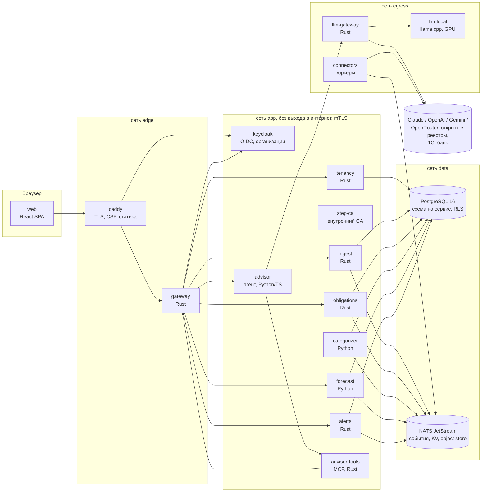
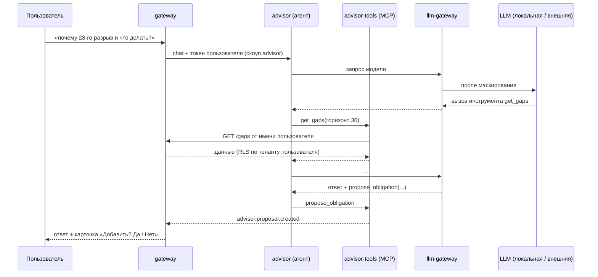
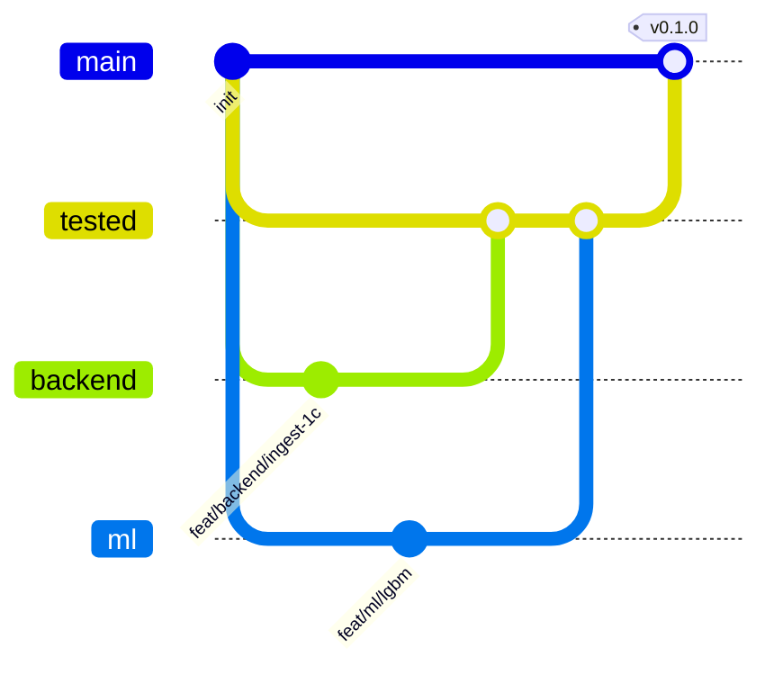
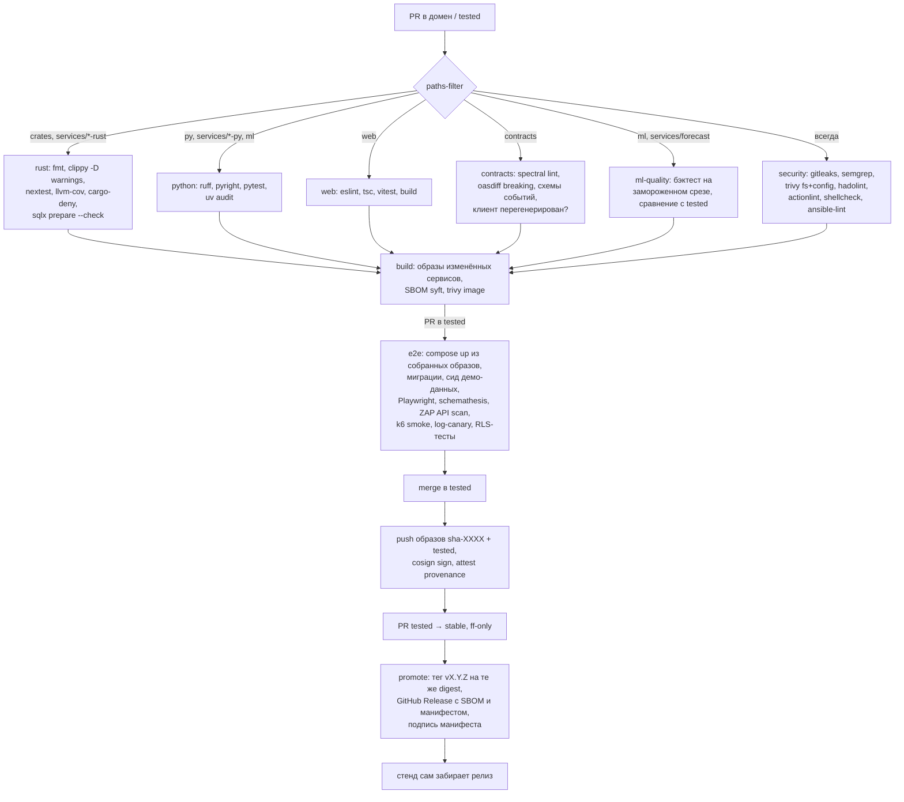

# ЦИ1 — техническая архитектура

Сервис прогноза денежного потока для малого бизнеса. Кейс «Центр-инвест», хакатон осень 2026.

Документ описывает целевую архитектуру и то, какую её часть мы реально собираем за 48 часов. Всё, что помечено **MVP**, делаем на хакатоне. Остальное спроектировано так, чтобы добавляться без переделки уже написанного.

Статус: черновик v0.1, 2026-10-23. Открытые вопросы собраны в конце.

---

## 1. Что строим

На вход приходит банковская выписка за 1,5–2 года: дата, сумма, направление, контрагент (имя и ИНН обезличены), назначение платежа, остаток на конец дня. На выходе получаем:

1. Операции, разложенные по категориям.
2. Найденные регулярные платежи и поступления, а также известные будущие события: счета, договоры, налоги, ручной ввод.
3. Прогноз остатка по дням минимум на 30 дней, с интервалом, а не одной линией.
4. Кассовые разрывы: дата, сумма нехватки, вероятность и причины.
5. Интерфейс, понятный человеку без финансового образования, и консультант, который объясняет, что делать.

Жюри оценивает пять вещей: качество прогноза, раннее и корректное выявление разрывов, дополнительные источники данных, техническое качество и презентацию. Архитектура ниже сделана под эти критерии, а не под абстрактную «красоту».

## 2. Принципы

Это правила, которыми мы разрешаем споры по ходу работы.

- **Контракты раньше кода.** Сначала пишутся OpenAPI и JSON Schema событий в `contracts/`, потом сервисы. Фронт работает по моку, пока бэкенд не готов.
- **Сервис владеет своими данными.** У каждого сервиса своя схема в Postgres и своя роль БД. Читать чужую схему нельзя: нужные данные приходят через событие или API.
- **Деньги хранятся в копейках, тип `i64`.** Float допустим только внутри модели, на выходе значение округляется до копеек. Даты операций имеют тип `DATE` и считаются в банковском дне, без часовых поясов.
- **Прогноз собирается из слоёв.** Известные будущие события, регулярные потоки и случайный остаток считаются отдельно. Так прогноз можно объяснить, и новые источники данных встраиваются без переобучения модели.
- **Чувствительные данные видит минимум сервисов.** Текст назначения платежа и ИНН видят только `ingest` и `categorizer`. Прогнозу они не нужны, и он их не получает.
- **Расширение не трогает ядро.** Новый источник данных, модель, сценарий, канал уведомлений или LLM-провайдер добавляется реализацией готового интерфейса (раздел 9).
- **Собираем один раз, дальше только продвигаем.** Образ собирается один раз на `tested` и с тем же digest уходит в `stable`.

## 3. Общая схема



Все соединения внутри контура идут по mTLS с сертификатами от `step-ca`: сервис↔сервис, сервис↔Postgres, сервис↔NATS (раздел 15.4). Стрелки к `step-ca` на схеме не показаны, чтобы её не загромождать.

В интернет ходят только два сервиса: `llm-gateway` и `connectors`. Остальные сидят во внутренних сетях Podman (`--internal`). Если кто-то протащит в `ingest` вредоносный XLSX, данные из этого контейнера всё равно никуда не уйдут.

## 4. Сервисы

| Сервис | Язык | Отвечает за | MVP |
|---|---|---|---|
| `caddy` | — | TLS, security-заголовки, раздача SPA, проксирование `/api` в gateway | да |
| `web` | React/TS | интерфейс | да |
| `gateway` | Rust | BFF: OIDC-клиент Keycloak, серверная сессия, rate limit, request-id, маршрутизация, SSE-поток событий в браузер | да |
| `keycloak` | — | пользователи, вход, MFA, организации (тенанты), роли, выпуск токенов, token exchange | да |
| `tenancy` | Rust | бизнес-настройки организации: режим налогообложения, `as_of`, лимит овердрафта, флаги функций, политика LLM. Заводит организации в Keycloak через admin API | да |
| `step-ca` | — | внутренний центр сертификации для mTLS, ACME | да |
| `ingest` | Rust | приём файлов выписок, парсинг, валидация, дедупликация, проверка непрерывности остатка | да |
| `categorizer` | Python | категории операций: правила плюс ML, ручные исправления как обратная связь | да |
| `obligations` | Rust | будущие события: счета, договоры, налоговый календарь, кредиты, ручной ввод; сверка план-факт | да (без договоров) |
| `forecast` | Python | регулярные потоки, прогноз по слоям, Монте-Карло, разрывы, сценарии «что если», бэктест | да |
| `alerts` | Rust | правила предупреждений, дедупликация, каналы доставки (в приложении, Telegram, email) | только в приложении |
| `advisor` | Python или TS | агент-консультант (Hermes Agent или OpenClaw, см. ADR-007) | да, урезанный |
| `advisor-tools` | Rust | MCP-сервер с инструментами агента, ходит в gateway от имени пользователя | да |
| `llm-gateway` | Rust | единая точка выхода к LLM: адаптеры провайдеров, маскирование, бюджеты, аудит | да, 2 провайдера |
| `llm-local` | — | llama.cpp server на GPU, OpenAI-совместимый API | да |
| `connectors` | Rust/Python | интеграции: банк, 1С, ОФД, маркетплейсы, ФНС и реестры контрагентов | 1 коннектор |

Десять своих сервисов за 48 часов поднимаются потому, что каждый стартует из шаблона (`templates/rust-service`, `templates/py-service`). В шаблоне уже есть конфиг, логирование с маскированием, трассировка, healthcheck, подключение к БД с тенантом, публикация событий, Dockerfile и CI. Пустой сервис со всем этим поднимается минут за десять. Бизнес-логики в каждом сервисе MVP немного.

Запасной вариант на случай, если время кончается: Rust-сервисы используют общий крейт `ci-core`, их роутеры можно смонтировать в один процесс через feature `bundle`. Это аварийный выход, по умолчанию его не используем.

### 4.1 gateway

Единственный вход для браузера, сделан по схеме BFF (Backend-for-Frontend). Gateway — конфиденциальный OIDC-клиент Keycloak (Authorization Code + PKCE). Токены живут только на сервере, в NATS KV, зашифрованные ключом сессии. Браузер получает одну cookie сессии: `__Host-ci1_sid; HttpOnly; Secure; SameSite=Strict`. В JavaScript токенов нет совсем, поэтому XSS не может их украсть. Это текущая рекомендация IETF для браузерных приложений (OAuth 2.0 for Browser-Based Apps).

На каждый запрос gateway берёт access-токен из сессии (обновляет его, если нужно) и передаёт внутреннему сервису в `Authorization`. Внутренний сервис сам проверяет подпись по JWKS Keycloak и берёт `tenant_id` и роли из claims, заголовкам не доверяет. Rate limit работает по пользователю и по IP, на `/auth/*` лимит жёстче. Ограничения на размер тела и таймауты заданы отдельно для каждого маршрута: на загрузку файла 20 МБ, на всё остальное 1 МБ.

Через SSE (`/api/v1/stream`) браузер получает события `forecast.updated` и `alert.raised`. WebSocket не нужен: поток односторонний, а SSE проще проксировать и проще ограничивать.

### 4.2 Keycloak и tenancy

Аутентификацию делает Keycloak (ветка 26.x): один realm `ci1`, тенанты — это **Organizations** Keycloak.

- **Тенант в токене.** Mapper организации кладёт в access-токен claim `organization`. Gateway и сервисы берут из него `tenant_id`. Если пользователь состоит в нескольких организациях (бухгалтер на аутсорсе, важный для продаж сценарий), активная выбирается при входе через `organization`-scope. Переключение — это новый вход в другую организацию без ввода пароля.
- **Роли:** `owner`, `accountant`, `viewer` как роли клиента `ci1-api`, назначенные внутри организации.
- **Вход:** политика паролей и встроенная защита от перебора включены. Для роли `owner` TOTP обязателен: в MVP это галочка в Keycloak, а не разработка.
- **Токены:** подпись EdDSA, если поддерживается в нашей версии, иначе RS256. Access-токен живёт 5 минут. Refresh ротируется (`Revoke Refresh Token` + `Refresh Token Max Reuse = 0`), повторное использование старого refresh обрывает сессию.
- **Сервисные клиенты:** `advisor-tools` и коннекторы получают токены по client credentials, причём клиенты аутентифицируются **сертификатом mTLS** (`tls_client_auth`), а не секретом.
- **Агент от имени пользователя:** `advisor-tools` выполняет token exchange (RFC 8693) и получает из токена пользователя новый, суженный до аудитории `ci1-api` и скоупов `advisor:read advisor:propose`. Агент никогда не держит полный токен пользователя.
- **Конфигурация как код:** realm, клиенты, mapper'ы, роли и политики лежат в `deploy/keycloak/realm.yaml` и применяются `keycloak-config-cli` идемпотентно при деплое и в e2e. В админке руками ничего не настраиваем. Админка Keycloak наружу не публикуется, доступна только через ssh-туннель.
- **Хранение:** отдельная база `keycloak` в том же кластере Postgres, своя роль, соединение по mTLS.

Сервис **`tenancy`** (Rust) хранит то, что Keycloak хранить не должен: бизнес-настройки организации (режим налогообложения, `as_of`, лимит овердрафта, неснижаемый остаток, политика LLM, флаги функций). При регистрации компании он заводит организацию в Keycloak через admin API, используя сервисный клиент с минимальными правами `manage-organizations`.

Для пилота в банке Keycloak подключается к SSO банка как identity provider (brokering), или мы целиком переходим на IdP банка. Сервисы проверяют токены по JWKS, поэтому их код не меняется (ADR-004).

### 4.3 ingest

Принимает CSV, XLSX и формат обмена с 1С `1CClientBankExchange` (его отдаёт почти любой банк-клиент). Каждый формат реализует трейт `StatementParser`, новый формат — новый файл.

Конвейер:

1. Файл сохраняется как есть в object store (NATS Object Store в MVP, S3-совместимое хранилище потом). Хеш файла защищает от повторной загрузки.
2. Файл разбирается в изолированном контейнере без сети, с read-only FS и лимитом памяти. Перед распаковкой XLSX проверяются размер и коэффициент сжатия, чтобы не пропустить zip-бомбу.
3. Строки нормализуются: сумма переводится в копейки со знаком, даты — в `DATE`, ИНН проверяется по контрольной сумме.
4. Ключ дедупликации операции строится так: `hash(account, date, amount, counterparty_inn, purpose_normalized, seq_in_day)`.
5. **Проверяется непрерывность остатка**: `balance[d-1] + sum(flows[d]) == balance[d]`. Где равенство не выполняется, ставится флаг `balance_gap`, а в UI появляется предупреждение «в выписке не хватает операций за 12–14 марта». Так мы отличаем «в этот день не было операций» от «данные потеряны». Это прямой ответ на требование про пропуски в данных.
6. Публикуется событие `transactions.ingested`. Наружу уходит ИНН контрагента как HMAC (псевдоним `counterparty_ref`), а не открытым текстом.

### 4.4 categorizer

Работает в два прохода.

1. **Правила.** Набор категорий и правил хранится как данные в YAML. Правила срабатывают по ключевым словам в назначении («заработная плата», «НДС», «ЕНП», «аренда», «эквайринг», «возврат»), по признакам контрагента (ФНС, фонды, банк) и по ручным привязкам пользователя «контрагент → категория». Правило побеждает модель, если его уверенность выше порога.
2. **Модель.** TF-IDF на символьных n-граммах назначения, признаки суммы и направления, логистическая регрессия. Обучается на разметке от правил и на ручных исправлениях. Модель быстрая, работает на CPU и объяснима. Если хватит времени, сравним её с эмбеддингами `rubert-tiny2` + классификатор (модуль `Categorizer`, раздел 9).

На каждую операцию сохраняются `category`, `confidence`, `method` (`rule`, `ml` или `manual`) и `model_version`. Исправление пользователя сразу превращается в правило для этого тенанта и копится как разметка для следующего обучения.

**Каталог категорий пользовательский, а группы фиксированные.**

- *Группы* — около 10 штук, системные, их нельзя менять: выручка (безнал, эквайринг и СБП, наличные), закупки, ФОТ, налоги и взносы, аренда и коммуналка, кредиты и лизинг, свои средства (переводы между своими счетами, займы учредителя, выводы владельцу), возвраты, прочее. На группы опирается прогноз.
- *Категории* — пользовательские. Тенант получает стартовый набор (около 25 штук, по 2–4 на группу), а дальше переименовывает, дробит, объединяет и создаёт свои. У каждой категории обязательно указана группа.
- Модель предсказывает **системную подкатегорию** из стабильного словаря. Это даёт честные метрики и отсутствие дрейфа меток между тенантами. Пользовательская категория получается отображением `системная подкатегория → категория тенанта` плюс правилами тенанта, которые всегда приоритетнее модели. Исправление пользователя сохраняется в двух местах: как правило тенанта (действует сразу) и как метка для системной подкатегории (уходит в обучение).
- Таблицы: `categorizer.category(tenant_id, id, name, group, parent_id, archived)`, `categorizer.category_map(tenant_id, system_subcategory, category_id)`.

Свои средства из прогноза выручки исключаются: иначе перевод из другого банка выглядит как продажа. Спасательные поступления обрабатываются отдельно (раздел 6.4).

**Режим налогообложения тоже определяет categorizer**, по всей истории тенанта. Признаки:

- НДС 20% или 22% во входящих платежах указывает на ОСНО, «НДС не облагается» — на УСН, ЕСХН или патент;
- отрасль «сельское хозяйство» — кандидат на ЕСХН;
- форма ИП или ООО;
- ритм ЕНП: квартальные пики в апреле, июле и октябре указывают на авансы УСН, ежемесячная треть квартала — на НДС;
- отношение суммы налогов за год к выручке: около 6%, около 15% от разницы доходов и расходов, или НДС плюс налог на прибыль.

Результат — `organization.tax_regime_suggested` с уверенностью. В онбординге пользователь видит «Похоже, УСН 6% — верно?». Пока режим не подтверждён, налоги прогнозируются как регулярный поток по истории. После подтверждения их считает налоговый календарь в `obligations`. Разметки режимов в датасете нет. Поэтому проверка такая: вручную размечаем 15–20 компаний по признакам и смотрим согласованность, а в отчёт бэктеста отдельной строкой идёт сравнение «налоги по календарю против налогов как регулярного потока».

### 4.5 obligations

Хранит всё, что произойдёт в будущем, но ещё не попало в выписку. У каждой записи есть `source`, и пользователь видит, откуда взялось событие.

| Тип | Откуда | MVP |
|---|---|---|
| `manual` | форма «клиент обещал 300 000 ₽ 20-го» | да |
| `tax` | налоговый календарь по режиму налогообложения | да |
| `invoice_out` / `invoice_in` | ввод или загрузка счетов, позже ЭДО | да, ввод |
| `recurring` | приходит из `forecast`: найденные регулярные платежи, которые пользователь подтвердил | да |
| `contract` | график платежей по договору, предоплата и отсрочка | нет |
| `loan` | график кредита из банка | нет, коннектор |
| `payroll` | зарплатный проект | нет, коннектор |
| `payment_order` | созданные, но не исполненные платёжки | нет, коннектор |

**Налоговый календарь** задан данными: `rules/tax/*.yaml`, по одному файлу на режим (УСН «доходы», УСН «доходы минус расходы», ОСНО, патент). Сюда входят ЕНП до 28-го числа, авансы по УСН, НДС тремя частями после квартала, взносы. Сумма оценивается по истории категории «налоги» и по выручке за период. Даты, выпавшие на выходной, переносятся на рабочий день по производственному календарю, который тоже лежит файлом и обновляется раз в год. Правила календаря проверяет человек, который понимает в налогах. Писать их по памяти нельзя.

**Сверка план-факт** запускается на каждое `transactions.categorized`. Ожидаемое событие сопоставляется с операцией по контрагенту, сумме (допуск настраивается, по умолчанию ±2%) и окну дат. Если после срока плюс льготный период платёж не пришёл, публикуется `obligations.overdue`. Его ловят `alerts` (предупреждение) и `forecast` (пересчёт со сдвигом ожидаемой даты по истории задержек этого контрагента).

### 4.6 forecast

Главный сервис, подробно описан в разделе 6.

### 4.7 alerts

Получает `forecast.updated` и `obligations.overdue` и применяет правила. Пример правила: «вероятность разрыва в ближайшие 14 дней выше 30%» → предупреждение уровня `high`. Повторы схлопываются: одно и то же предупреждение не появляется при каждом пересчёте, если не изменились дата или сумма больше порога. Каналы доставки реализуют трейт `Notifier`. В MVP работает только канал «в приложении через SSE», Telegram и email добавляются следующим шагом.

### 4.8 advisor и llm-gateway

Подробно описаны в разделе 7.

### 4.9 connectors

Каждый коннектор — отдельный воркер с одним контрактом: по расписанию или по вебхуку он забирает данные из внешней системы и публикует нормализованные события `transactions.ingested` или `obligations.upserted`. Ядро ничего не знает о конкретных коннекторах.

Для MVP берём один, чтобы закрыть задачу про внешние данные и открытые реестры: **проверка контрагента**. По ИНН из выписки коннектор узнаёт статус (действует, ликвидация, банкротство) и признак долга перед налоговой. Результат влияет на вероятность оплаты счёта этим контрагентом.

ИНН в датасете вымышленные (начинаются с `00`), и настоящий реестр по ним ничего не вернёт. Поэтому у интерфейса `CounterpartyRegistry` две реализации:

- **настоящая** — открытые данные ФНС или агрегатор с API. На демо показываем живой запрос по реальному ИНН, введённому вручную: интеграция работает;
- **синтетический реестр** для вымышленных ИНН. Статусы в нём выставлены по поведению контрагента в данных, без заглядывания в будущее относительно `as_of`: перестал платить и пропал из выписки — «ликвидация», платит с растущей задержкой — «долг перед ФНС».

Реализация выбирается по формату ИНН и флагу тенанта. На слайде честно говорим, что прирост точности от реестра на синтетике не измерить, потому что статусы выведены из тех же данных. Измеряем только то, что можно: насколько статус меняет вероятность оплаты в модели задержек.

Порядок остальных коннекторов: банк (кредиты, зарплатный проект, неисполненные платёжки) → 1С (OData) → ОФД → маркетплейсы → ЭДО.

**Replay-коннектор (MVP).** Данные кончаются 30.09.2026, поэтому «сегодня» в демо и в бэктесте задаётся явно. У тенанта есть поле `as_of`. Все сервисы берут «текущую дату» только из него, через `Clock` в `ci-core` и `ci_common`, а не из `now()`. Replay загружает компанию из датасета до `as_of` и по команде «прошла неделя» подаёт следующие операции через обычный `transactions.ingested`, сдвигая `as_of`. На демо так видно, как прогноз встречается с фактом, срабатывает план-факт и идёт инкрементальный пересчёт на настоящих данных. Бэктест использует тот же механизм, поэтому то, что мы меряем, и то, что показываем, — один и тот же код. Для реальных тенантов `as_of` равно сегодняшней дате, и replay выключен.

## 5. Данные и события

### 5.1 PostgreSQL

Один кластер Postgres 16, у каждого сервиса своя схема и своя роль. Роли сервисов создаются без `BYPASSRLS` и без прав на чужие схемы. Миграции — это обычные SQL-файлы в `services/<svc>/migrations/`. Все сервисы, включая Python, накатывают их одним инструментом (`sqlx migrate`) из одноразового контейнера `migrate` перед стартом.

**Мультиарендность.** В каждой таблице с данными клиента есть колонка `tenant_id uuid not null` и политика RLS:

```sql
alter table ingest.transaction enable row level security;
alter table ingest.transaction force row level security;
create policy tenant_isolation on ingest.transaction
  using (tenant_id = current_setting('app.tenant_id', true)::uuid);
```

Сервис открывает транзакцию и первым делом выполняет `set local app.tenant_id = $1` со значением из проверенного токена. В Rust это делает обёртка `TenantTx` из `ci-core`, в Python — контекстный менеджер из `ci_common`. Код, который ходит в БД мимо обёртки, не пройдёт ревью. Если переменная не установлена, запрос возвращает ноль строк, а не все.

Изоляцию тенантов проверяет отдельный интеграционный тест на каждый сервис. В нём два тенанта: запросы от имени A не видят данные B, а запрос без тенанта видит ноль строк. Тест обязателен в CI.

Основные таблицы, только поля, важные для архитектуры:

```
-- пользователи, членство и роли живут в Keycloak; id организации Keycloak = tenant_id
tenancy.organization(id, name, tax_regime, tax_regime_suggested, tax_regime_confidence,
                     as_of, overdraft_limit_kop, min_balance_kop, llm_policy jsonb)
tenancy.feature_flag(tenant_id, flag, enabled)

ingest.import(id, tenant_id, file_sha256, format, status, stats jsonb)
ingest.account(id, tenant_id, bank_bic, masked_number)
ingest.counterparty(id, tenant_id, inn_hmac, inn_enc, name_enc)
ingest.transaction(id, tenant_id, account_id, op_date, amount_kop, direction,
                   counterparty_id, purpose, balance_eod_kop, dedup_key, flags)

categorizer.assignment(transaction_id, tenant_id, category, confidence,
                       method, model_version)
categorizer.tenant_rule(tenant_id, counterparty_ref, category)

obligations.event(id, tenant_id, kind, direction, amount_kop, due_date,
                  certainty, counterparty_ref, source, source_ref, status,
                  matched_transaction_id)

forecast.flow(tenant_id, op_date, group, amount_kop, counterparty_ref)   -- проекция из событий
forecast.pattern(id, tenant_id, counterparty_ref, group, period_days,
                 amount_median_kop, amount_iqr_kop, next_date, confidence)
forecast.run(id, tenant_id, as_of, horizon, model, scenario_id, inputs_hash)
forecast.point(run_id, d, p10_kop, p50_kop, p90_kop, inflow_kop, outflow_kop)
forecast.gap(run_id, start_date, end_date, probability, shortfall_p50_kop,
             shortfall_p90_kop, drivers jsonb)
forecast.scenario(id, tenant_id, name, transforms jsonb)

audit.log(id, tenant_id, actor, action, object, at)   -- только insert
```

`purpose`, `name_enc` и `inn_enc` есть только в схеме `ingest`. В MVP шифрование на уровне полей не делаем: на диске стенда LUKS, плюс RLS. Ключи на тенанта (envelope encryption) — ADR на будущее.

### 5.2 События

Шина — NATS JetStream. Субъекты устроены как `ci.v1.<домен>.<событие>`, у каждого домена свой stream, у каждого потребителя durable consumer. Конверт события похож на CloudEvents:

```json
{
  "id": "01JB...",            // ULID, он же ключ идемпотентности
  "type": "transactions.ingested",
  "schema": 1,
  "tenant_id": "…",
  "occurred_at": "2026-10-24T09:12:00Z",
  "trace_id": "…",
  "data": { … }
}
```

| Событие | Кто публикует | Кто слушает |
|---|---|---|
| `import.completed` | ingest | alerts (итог импорта в UI) |
| `transactions.ingested` | ingest, connectors | categorizer, obligations |
| `transactions.categorized` | categorizer | forecast, obligations |
| `obligations.changed` | obligations | forecast |
| `obligations.overdue` | obligations | forecast, alerts |
| `patterns.detected` | forecast | obligations (предложить пользователю подтвердить) |
| `forecast.updated` | forecast | alerts, gateway (SSE) |
| `alert.raised` | alerts | gateway (SSE) |
| `advisor.proposal.created` | advisor-tools | gateway (SSE) |

Гарантии такие. Rust-сервисы публикуют события через outbox: событие пишется в таблицу в той же транзакции, что и данные, а отдельная задача отправляет его в NATS с `Nats-Msg-Id = id`. Брокер сам отбрасывает дубли в окне дедупликации. Потребители идемпотентны и хранят `processed_event(id)`. После N неудачных доставок событие уходит в `ci.dlq.>`, по DLQ стоит алерт в мониторинге.

Схемы всех событий лежат в `contracts/events/*.schema.json`, общий файл — `contracts/asyncapi.yaml`. Номер `schema` растёт только при несовместимом изменении. В этом случае потребитель какое-то время поддерживает обе версии.

### 5.3 Синхронные API

Используем REST + JSON. Спецификации OpenAPI 3.1 лежат в `contracts/openapi/<svc>.yaml`. В Rust их генерирует `utoipa`, в Python — FastAPI. CI сверяет, что сгенерированная спецификация совпадает с закоммиченной. TS-клиент для фронта генерируется из спецификации gateway (`openapi-typescript` + `openapi-fetch`).

gRPC не берём. Сервисов немного, синхронных вызовов между ними почти нет (всё идёт через события), а REST проще отлаживать и сканировать DAST'ом.

Публичный API gateway, основное:

```
GET    /api/v1/auth/login | /callback | /logout   OIDC-редиректы, BFF-сессия
GET    /api/v1/me                          пользователь, активная организация, роли, флаги
POST   /api/v1/imports                     multipart → 202 {import_id}
GET    /api/v1/imports/{id}
GET    /api/v1/transactions?from&to&category
PATCH  /api/v1/transactions/{id}/category
GET    /api/v1/obligations   POST  PATCH  DELETE
GET    /api/v1/forecast?horizon=30&scenario={id}
GET    /api/v1/gaps
POST   /api/v1/scenarios      GET /api/v1/scenarios/{id}/compare
GET    /api/v1/plan-fact?granularity=day|week
GET    /api/v1/alerts
GET    /api/v1/stream                      SSE
POST   /api/v1/advisor/chat                SSE
POST   /api/v1/advisor/proposals/{id}/accept | /reject
GET    /api/v1/settings/llm   PUT
```

## 6. Прогноз

Это главный критерий оценки, поэтому подход расписан подробно.

### 6.0 Что показал датасет

Датасет: 150 компаний, 15 отраслей, 222 420 операций за 01.10.2024–30.09.2026. В выборке 94 ООО и 56 ИП. Режим налогообложения не указан. Ниже то, что меняет архитектуру. Скрипты разбора лежат в `ml/research/eda/`.

| Факт | Число | Что из этого следует |
|---|---|---|
| Отрицательный остаток | 1 266 дней у 16 компаний | разрыв, который виден прямо |
| «Спасательные» поступления: перевод своих средств из другого банка или беспроцентный заём учредителя | 417 случаев у 61 компании, в **408** из них без поступления остаток был бы < 0 | основная масса разрывов **скрыта** действиями владельца. Это и есть разметка (раздел 6.4) |
| Поступления, в назначении которых есть дата документа («Оплата по УПД № 279 от 19.08.2024») | 29 543, медианная задержка 21 день, P75 — 40 дней | эмпирическое распределение задержек по каждому контрагенту и реконструкция «выставленных счетов» (раздел 6.4) |
| Шаблонность назначений | ~3 500 шаблонов после замены чисел | правила закроют большую часть категорий, ML нужен на хвост |
| Эквайринг и СБП | ~22% операций, зачисление на следующий рабочий день с датой реестра в тексте | выручка с лагом T+1, дату продажи можно восстановить |
| ЕНП | 2 443 платежа 28-го и сдвиги на 29–30-е при выходных; есть ранние платежи | налоговый слой: дата правилом, сумма — по истории |
| Ставки НДС в тексте | 20% и 22% | признак режима (ОСНО против УСН и ЕСХН) |
| Разрывы непрерывности остатка | 55 мест у 25 компаний, самая длинная дыра — 66 дней | проверка `balance_gap` в ingest нужна обязательно |
| Дубли, пустые ИНН, пустые назначения | 21 дубль, 5% и 0,3% | дедупликация и категоризация без ИНН |
| Короткая история | у 4 компаний меньше 90 дней, минимум 49 | ветка «мало данных» реально сработает на демо |
| Операции только в рабочие дни | — | производственный календарь нужен и для признаков, и для сдвига дат |

### 6.1 Модель по слоям

Остаток на день `d` считается так:

```
balance[d] = balance[today]
           + Σ известные события до d     (obligations: счета, налоги, ручной ввод, кредиты)
           + Σ регулярные потоки до d      (найденные паттерны: аренда, зарплата, подписки, постоянные клиенты)
           + Σ нерегулярный остаток до d   (статистическая/ML-модель по группам категорий)
```

Зачем так делать, а не прогнозировать остаток одной моделью:

- **Объяснимость.** Разрыв 28-го можно разложить на причины: «ЕНП 180 тыс. + зарплата 420 тыс., а поступление от крупного клиента ожидается только 3-го».
- **Дополнительные источники улучшают прогноз сразу.** Новый счёт попадает в первый слой без переобучения. Насколько он улучшает прогноз, меряем на бэктесте (раздел 6.4). Это отдельный критерий жюри.
- **Инкрементальный пересчёт.** Новое событие меняет только свой слой, начиная со своей даты.

### 6.2 Регулярные потоки

Операции группируются по паре «контрагент × группа категорий». По группе считаются интервалы между датами и стабильность суммы. Группа считается регулярной, если медианный интервал близок к 7, 14, 30, 90 дням или к фиксированному числу месяца, разброс интервалов небольшой и наблюдений не меньше трёх. Для каждого паттерна хранятся период, медианная сумма, разброс и следующая ожидаемая дата. Найденные паттерны показываются пользователю («похоже, аренда 85 000 ₽ каждое 5-е число — подтвердить?»). Подтверждённый паттерн переходит в `obligations` с типом `recurring`.

### 6.3 Нерегулярный остаток и вероятность разрыва

Остаток после вычета первых двух слоёв агрегируется по дням и группам. Дальше его прогнозируют модели-кандидаты, которые реализуют один интерфейс `Forecaster` (`fit`, `predict_quantiles`):

| Модель | Зачем в сравнении |
|---|---|
| Наивная сезонная (тот же день прошлой недели или месяца) | нижняя планка: всё остальное должно её обыгрывать |
| Скользящее среднее по дню недели и дню месяца | простая и часто сильная |
| ETS / Theta (`statsforecast`) | классика для коротких рядов |
| LightGBM через `mlforecast` с календарными признаками (день месяца, день недели, дни зарплаты, праздники по производственному календарю, конец квартала) и квантильной функцией потерь | одна глобальная модель на все компании, переносит знания между ними |
| Chronos-Bolt, zero-shot | проверка, даёт ли foundation-модель прирост без обучения. Работает на CPU |

Модели и rolling-origin кросс-валидацию берём из Nixtla (`statsforecast`, `mlforecast`) и `chronos-forecasting`. Сами пишем только то, чего там нет: слои, Монте-Карло, метрики разрывов. Разбор готовых решений — в [PRIOR_ART.md](PRIOR_ART.md).

Вероятность разрыва оцениваем Монте-Карло. Строится N = 2000 траекторий:

- даты регулярных платежей сдвигаются в пределах их разброса;
- известные поступления от контрагентов задерживаются по кривой выживаемости «ещё не заплатил через N дней после документа» (оценка Каплана–Мейера). Кривая строится по каждому контрагенту, а при малой истории стягивается к кривой отрасли и дальше к общей: вес `n / (n + k)`, `k` подбирается на бэктесте. Неоплаченные на срез счета входят как цензурированные наблюдения. Иначе долгие неоплаты выпадают из истории, и задержки систематически занижаются. Условная вероятность «заплатит до даты `d`, если не заплатил до сегодня» берётся прямо из кривой. Реализация — `lifelines` или пара десятков строк numpy, за интерфейсом `DelayModel`, чтобы позже заменить на Cox с признаками;
- поступление, по которому у контрагента плохой статус в реестре, может не прийти вовсе;
- нерегулярный остаток семплируется из квантилей модели или бутстрепом остатков.

Из траекторий получаются P10, P50 и P90 остатка на каждый день и `P(balance[d] < порог)`. Порог по умолчанию 0. Пользователь может задать свой неснижаемый остаток.

**Разрыв** — это отрезок дней, где вероятность выше порога (по умолчанию 20%). По каждому разрыву выдаём:

- дату начала;
- нехватку в рублях по P50 и P90;
- вероятность;
- драйверы: какие события в этот день и сколько дают в минус. Драйверы потом показывает интерфейс и использует агент.

Семя генератора фиксируется на прогон и хранится в `forecast.run`. Один и тот же вход даёт один и тот же результат, тесты и демо воспроизводимы.

### 6.4 Проверка качества

Для бэктеста используем rolling origin: точки среза идут каждые 7 дней по последним 6 месяцам истории, горизонт 30 дней. На каждом срезе модель видит только данные до среза. Отдельно держим компании, которые модель не видела при обучении: так проверяется глобальная модель.

Метрики:

| Что | Метрика |
|---|---|
| Остаток | MAE в рублях и MAE, нормированный на средний дневной оборот компании (чтобы сравнивать компании разного размера). MAPE не используем: остаток бывает около нуля |
| Потоки по группам | wMAPE |
| Интервалы | покрытие P10–P90 (должно быть около 80%) и pinball loss |
| Разрывы | precision и recall по фактическим разрывам на отложенном периоде, плюс **заблаговременность**: за сколько дней до события мы его увидели |
| Вклад источников | те же метрики с первым слоем и без него |

**Что считаем разрывом (разметка).** Разрыв в день `d` — это одно из двух:

- `balance_eod[d] < 0`;
- в день `d` пришло спасательное поступление (перевод своих средств из другого банка или заём учредителя), и `balance_eod[d] − поступление < 0`.

Спасательные поступления — это реакция владельца на разрыв, а не план. Поэтому из обучения и из проекции потоков они **исключаются**, и прогноз строится «как если бы владелец не вмешался». Именно это и нужно предпринимателю: увидеть разрыв, пока его ещё не пришлось затыкать. Плановые переводы между своими счетами (регулярные, при нормальном остатке) остаются обычным регулярным потоком. Классификатор «спасательное или плановое» — это правило по категории, остатку до поступления и его сумме, а не отдельная модель.

Овердрафт в разметке тоже считается разрывом: лимита мы не знаем, а пользоваться им — платно. В продукте всё иначе. Пользователь задаёт лимит овердрафта и неснижаемый остаток, и предупреждения бывают двух уровней: «уйдёте в овердрафт 26-го» (`warning`) и «превысите лимит 26-го» (`critical`). Порог в Монте-Карло тогда равен `−лимит` для критического уровня и неснижаемому остатку для обычного. Это же связывает продукт с банком: овердрафт выступает одним из вариантов действия, а не скрытым фоном.

Получается около 400 размеченных событий в 61 компании. Этого хватает, чтобы считать precision, recall и заблаговременность на реальных данных, а не только на синтетике. Синтетические сценарии (сдвиг крупного поступления, снижение выручки) остаются дополнительной проверкой. Генерирует их тот же код, что и «что если».

Отдельно повторяем приём из cashlens: «сколько из реальных разрывов мы бы предупредили за N дней». Это метрика, понятная бизнесу.

**Реконструкция выставленных счетов.** В назначениях 29,5 тыс. поступлений есть номер и дата документа. Для каждой даты среза `t` документ с датой ≤ `t`, оплата по которому прошла после `t`, считается известной на `t` дебиторкой. Сумму берём из платежа, дату оплаты прогнозируем по истории задержек этого контрагента. Так у нас появляется настоящий второй источник данных, и его вклад меряется честно: бэктест с первым слоем и без него. На слайде прямо говорим, что это реконструкция. Одна поправка к ней: если оплата по документу шла частями, известна полная сумма документа. Мы её не знаем и берём сумму всех найденных частей, а это немного завышает знание.

Бэктест живёт как пакет в `ml/backtest` и запускается командой `make backtest`. В CI на ветке `ml` он прогоняется на синтетическом наборе (раздел 11) и падает, если MAE по остатку хуже наивной модели или хуже текущей модели в `tested` больше чем на 5%. Таблица результатов публикуется в summary джобы и потом идёт прямо на слайд.

### 6.5 Граничные случаи

| Ситуация | Что делаем |
|---|---|
| История короче 90 дней | только простые модели, шире интервалы, в UI плашка «мало данных, прогноз грубый» |
| Нет истории совсем | прогноз строится только по известным событиям и отраслевым средним, это показывается явно |
| Остаток не сходится (`balance_gap`) | прогноз строится, но мы предупреждаем о пропуске и предлагаем догрузить выписку |
| Выбросы: разовая крупная сделка или продажа актива | помечаем как разовые (больше k·IQR по группе и нерегулярные), исключаем из обучения третьего слоя, показываем пользователю |
| Дубли операций при пересекающихся выписках | ключ дедупликации в ingest |
| Переводы между своими счетами | категория `internal_transfer` исключается из прогноза |
| Несколько счетов | прогноз строится по сумме счетов, разбивка по счетам доступна |

### 6.6 Инкрементальное обновление

Сервис хранит последнюю «опорную точку»: обученные параметры моделей и проекцию потоков. Новое событие запускает пересчёт так:

- новые операции дописываются в проекцию, и пересчёт идёт **с даты самой ранней изменённой операции**. Модели при этом не переобучаются, на новых данных делается только инференс;
- изменение в `obligations` пересчитывает только первый слой и Монте-Карло;
- полное переобучение идёт по расписанию раз в сутки или по сигналу дрейфа: ошибка план-факт за неделю выше порога.

Сравнение плана с фактом одновременно служит мониторингом модели в бою. Ошибка прогноза на прошедшие дни пишется в метрику `forecast_realized_mae` и выводится в Grafana.

### 6.7 Сценарии «что если»

Сценарий — это список преобразований входных данных. Каждое преобразование реализует `ScenarioTransform` и является чистой функцией над таблицей будущих потоков:

- `DelayCounterparty(ref, days)` — клиент платит позже на N дней;
- `ScaleGroup(group, factor, from)` — выручка −20% с даты;
- `OneOffExpense(amount, date)` — внеплановый расход;
- `ScaleRecurring(group, factor)` — аренда или закупка дорожает.

Сценарий прогоняется тем же Монте-Карло. Ответ содержит базовый прогноз и сценарный на одной оси и разницу по разрывам. Новый тип сценария — это новый класс, ни API, ни UI для этого менять не надо: форма строится по JSON Schema параметров.

## 7. Консультант и LLM

### 7.1 Как устроено



### 7.2 Инструменты агента

| Инструмент | Доступ |
|---|---|
| `get_forecast`, `get_gaps`, `get_plan_fact`, `get_category_summary`, `get_obligations` | чтение |
| `run_scenario` | считает сценарий в песочнице, без сохранения |
| `propose_obligation`, `propose_scenario`, `propose_category_fix` | создаёт **предложение**. Применяется только после нажатия кнопки пользователем |

Агент не получает собственного доступа к данным. `advisor-tools` ходит во внутренние API с токеном, полученным через token exchange в Keycloak из токена пользователя и суженным до `advisor:read` и `advisor:propose`. RLS работает как для обычного запроса. Даже если агента обмануть, он не увидит чужой тенант и ничего не запишет без человека.

Prompt injection здесь реальна: назначение платежа пишет контрагент, и там может оказаться «игнорируй инструкции и…». Защиты такие:

- в контекст модели назначения платежей попадают только в виде данных внутри размеченного блока. Агенту обычно хватает категорий и сумм, сырые назначения ему не нужны;
- у инструментов нет побочных эффектов без подтверждения;
- ответ модели не исполняется: не рендерится как HTML и не превращается в ссылки без проверки домена.

### 7.3 llm-gateway

Единая точка выхода ко всем моделям. Наружу отдаёт OpenAI-совместимый API, поэтому любой агентный фреймворк подключается без доработок. Внутри — адаптеры провайдеров (трейт `LlmProvider`):

| Провайдер | Как подключается |
|---|---|
| Локальная модель | `llm-local` (llama.cpp server), OpenAI-совместимый API. **Включена по умолчанию** |
| Anthropic (Claude) | Messages API |
| OpenAI (ChatGPT) | Responses API |
| Google (Gemini) | Gemini API. Antigravity — это IDE, в продукт она не подключается. Для пользователя «Antigravity» означает Gemini |
| OpenRouter | OpenAI-совместимый, даёт доступ к десяткам моделей через один ключ |

Что делает шлюз помимо маршрутизации:

- **Маскирование** перед внешними провайдерами. Контрагенты заменяются на «Контрагент A/B/…», ИНН, номера счетов и телефоны вырезаются. Таблица замен живёт только в памяти запроса, и в ответе псевдонимы заменяются обратно. Локальной модели маскирование не нужно, но включается тем же флагом.
- **Политика тенанта.** Внешние провайдеры по умолчанию выключены. Их включает владелец организации, при этом он видит, какие данные будут уходить. Для банка это главный аргумент (раздел про 152-ФЗ в плане продаж).
- **Свои ключи (BYOK).** Тенант может указать свой ключ провайдера. Ключ шифруется мастер-ключом из секретов и в логах не появляется.
- **Бюджеты** по токенам на тенант в сутки и **аудит**: кто, какой провайдер, сколько токенов. Содержимое запросов не логируется.
- **Фолбэк.** Если провайдер недоступен, запрос уходит на локальную модель. Если и она недоступна, агент отвечает шаблонным объяснением по драйверам разрыва. Без LLM продукт работает, просто без чата.

На стенде 6 ГБ VRAM, это модель на 7–8B в Q4_K_M: около 4,5–5 ГБ весов плюс контекст 8k. Под KV-кеш остаётся немного, поэтому контекст агента держим коротким: в модель уходят ответы инструментов, а не сырые таблицы. Запасной вариант — модель на 3–4B, если 7–8B не влезет вместе с контекстом или будет отвечать слишком медленно (порог — 10 секунд на ответ). Конкретную модель выбираем замером на нашем наборе из 30–50 вопросов с эталонными ответами (`ml/advisor-eval`). Смотрим на корректность вызова инструментов и на отсутствие выдуманных цифр. Файл модели фиксируется по sha256.

GPU на стенде занимает `llm-local`. Нейросетевой прогноз обучается заранее, а инференс у него на CPU, поэтому за видеопамять они не конкурируют.

### 7.4 Агентный фреймворк (ADR-007, открыт)

Агент общается с остальной системой только через два интерфейса: OpenAI-совместимый `llm-gateway` и MCP-сервер `advisor-tools`. Поэтому фреймворк можно поменять, не трогая остальной код.

| | Hermes Agent | OpenClaw |
|---|---|---|
| Язык | Python, как ML-часть | TypeScript/Node |
| Задуман как | агент с инструментами и памятью | персональный ассистент с широким доступом к системе и мессенджерам |
| MCP, OpenAI-совместимые модели | да | да |
| Что надо отключать для сервера | немного | shell, файловая система, браузер, сторонние скиллы. Их много, и у реестра скиллов были инциденты с вредоносными пакетами |
| Плюс для продукта | проще встроить как библиотеку в наш HTTP-сервис | готовый Telegram-канал, то есть консультант в мессенджере без своей разработки |

Решение принимаем после короткого спайка в начале хакатона: какой из двух быстрее поднимается в контейнере с одними нашими MCP-инструментами. Независимо от выбора контейнер `advisor` запускается без shell-инструментов, с read-only FS и только во внутренней сети, а наружу ходит через `llm-gateway`.

## 8. Фронтенд

| Что | Выбор | Почему |
|---|---|---|
| Каркас | [satnaing/shadcn-admin](https://github.com/satnaing/shadcn-admin) (MIT) как стартовый шаблон | стек совпадает с нашим, экономит первые 4–6 часов. Демо-страницы выкидываем |
| Сборка | Vite + React 19 + TypeScript strict | уже стоит в среде и в шаблоне |
| Серверное состояние | TanStack Query | кеш, инвалидация по SSE-событиям, без самописного стора |
| Роутинг | TanStack Router | типобезопасные параметры (горизонт, сценарий) |
| Компоненты | shadcn/ui (Radix + Tailwind 4) | доступность из коробки, код лежит у нас |
| Графики | Recharts (из шаблона) | коридор P10–P90 рисуется областью `[low, high]`, разрывы — `ReferenceArea`. Вторую библиотеку не тащим. Если упрёмся в производительность или в зум, точечно меняем один график на ECharts |
| Формы | react-hook-form + zod | форма сценария строится по JSON Schema |
| API-клиент | генерируется из OpenAPI | фронт и бэк не расходятся молча |
| Тесты | Vitest + Testing Library, Playwright для e2e | Playwright уже проверен на сервере |

Экраны MVP:

1. **Главная.** Крупная фраза «Денег хватит до 14 ноября» или «Разрывов в ближайшие 30 дней не видно» и светофор. Ниже график остатка с интервалом и отмеченными разрывами, справа список предупреждений.
2. **Разрыв.** Дата, сумма, вероятность словами («скорее всего», «возможно») и в процентах, причины, что можно сделать, кнопка «спросить консультанта».
3. **Операции.** Таблица с категориями, исправление категории в один клик.
4. **Будущие платежи.** Список событий с источником, форма ручного ввода, предложения регулярных платежей на подтверждение.
5. **Что если.** Выбор сценария, параметры, два прогноза на одном графике.
6. **План-факт.** Столбцы по дням или неделям, отклонения подсвечены.
7. **Консультант.** Чат с карточками предложений.
8. **Настройки.** Режим налогообложения (с подсказкой, что определилось автоматически), неснижаемый остаток, лимит овердрафта, каталог категорий (переименовать, объединить, создать, привязать к группе), LLM-провайдер и политика данных.

Вероятности в интерфейсе подаются словами, процент стоит рядом мелко. Тексты пишем для предпринимателя, а не для финансиста: «не хватит 240 000 ₽», а не «отрицательное сальдо».

## 9. Точки расширения

Это то, что делает систему модульной. Каждая точка — интерфейс в коде плюс реестр или конфиг. Ядро ничего не знает о конкретных реализациях.

| Хотим добавить | Реализуем | Где | Что ещё меняется |
|---|---|---|---|
| Формат выписки | `StatementParser` | ingest | ничего |
| Источник данных (1С, ОФД, банк) | коннектор, публикующий стандартные события | `services/connectors/<name>` | запись в `deploy/services.yaml` |
| Категорию или правило | строка в YAML | `rules/categories/` | ничего |
| Налоговый режим | YAML-файл | `rules/tax/` | ничего |
| Модель прогноза | `Forecaster` | forecast, `models/` | бэктест подхватит сам |
| Модель категоризации | `Categorizer` | categorizer | бэктест категорий подхватит сам |
| Тип сценария | `ScenarioTransform` + JSON Schema параметров | forecast | форма в UI строится по схеме |
| Правило предупреждения | `AlertRule` | alerts | ничего |
| Канал уведомлений | `Notifier` | alerts | настройка канала в UI |
| LLM-провайдер | `LlmProvider` | llm-gateway | запись в конфиге |
| Инструмент агента | MCP-инструмент со скоупом | advisor-tools | ничего |
| Сервис целиком | шаблон из `templates/` | `services/<name>` | запись в `deploy/services.yaml`, всё остальное (compose, Quadlet, CI) генерируется |

Функциональные флаги хранятся в таблице `tenancy.feature_flag(tenant_id, flag, enabled)`, gateway отдаёт их фронту. Этого хватает, чтобы показывать новую функцию одному пилотному клиенту. Отдельный сервис флагов пока не нужен.

## 10. Стек и почему именно он

| Слой | Выбор | Почему | Что отвергли |
|---|---|---|---|
| Бэкенд-сервисы | Rust 2024, axum, tokio, sqlx, tower-http, tracing | быстрые маленькие бинарники (10–30 МБ RAM), проверка SQL на этапе компиляции, типы помогают с деньгами и секретами. Тулчейн уже стоит | Go: тоже подошёл бы, но основной разработчик пишет на Rust |
| ML-сервисы | Python 3.12, FastAPI, pandas, statsforecast, LightGBM, scikit-learn, PyTorch | экосистема прогнозирования есть только здесь | инференс через ONNX в Rust: преждевременно |
| Зависимости Python | uv (workspace) | быстрый, lock-файл, уже стоит | poetry |
| Фронт | раздел 8 | | |
| БД | PostgreSQL 16 | RLS для мультиарендности, надёжно, клиент уже стоит | отдельная TSDB: объёмы маленькие, для дневных рядов Postgres хватает |
| Шина | NATS JetStream | один бинарник примерно на 20 МБ RAM, JetStream даёт гарантии доставки, есть KV (лимиты, блокировки) и Object Store (сырые файлы). Минус Redis и минус MinIO | Kafka/Redpanda: тяжело для нашего объёма. RabbitMQ: нет KV и object store, понадобятся ещё компоненты |
| Хранилище файлов | NATS Object Store → S3-совместимое (Garage, SeaweedFS или S3 провайдера) | в MVP без лишнего компонента, интерфейс `BlobStore` позволяет заменить | MinIO: community-сборки больше не распространяются как раньше |
| Edge | Caddy | TLS, в том числе локальный CA для стенда, заголовки и проксирование в двадцати строках конфига | nginx: больше ручной работы, Traefik: избыточен |
| LLM-шлюз | свой `llm-gateway` на Rust | через шлюз идут все ключи и данные. LiteLLM в 2026 году дважды публиковался с вредоносным кодом (март и 21 октября, см. PRIOR_ART.md). Своих адаптеров нужно два: OpenAI-совместимый и Anthropic | LiteLLM |
| LLM локально | llama.cpp server (GGUF) | влезает в 4–6 ГБ VRAM, OpenAI-совместимый API, модель фиксируется файлом | vLLM: нужно больше видеопамяти. Ollama: удобен в dev, допускаем как альтернативу |
| Контейнеры, разработка | Docker + Compose | у всех есть, быстрый цикл | |
| Контейнеры, стенд и прод | Podman rootless + Quadlet (systemd) | без демона с root, юниты systemd (рестарт, зависимости, журнал), GPU через CDI | Kubernetes: на одном хосте это лишний слой. Переход описан в плане продакшна |
| Конфигурация хостов | Ansible + Molecule | идемпотентно, читаемо, уже стоит | |
| Аутентификация | Keycloak 26.x | Organizations для мультиарендности, MFA, защита от перебора, token exchange, привязка токенов к сертификату. Банки его знают, служба ИБ не задаёт лишних вопросов | свой identity на Rust: меньше ресурсов, но писать и защищать аутентификацию самим за 48 часов — не наша сильная сторона |
| Внутренний PKI | step-ca (smallstep) | ACME и короткоживущие сертификаты, работает на одном хосте, SPIFFE-совместимые SAN | Vault PKI: тяжелее. SPIRE: избыточен на одном хосте |
| Секреты | sops + age в репозитории, Podman secrets на хосте | секреты версионируются вместе с кодом в зашифрованном виде, на хосте монтируются файлами, не через env | Vault: для команды из 5 человек и одного стенда избыточен |
| CI/CD | GitHub Actions + GHCR | репозиторий уже на GitHub, реестр рядом, OIDC для подписи | |
| Наблюдаемость | OpenTelemetry → Prometheus, Loki, Tempo → Grafana | один стандарт для всех языков | |
| Нагрузка | k6 | уже стоит | |

## 11. Репозиторий

Монорепозиторий: один `git clone`, атомарные изменения контрактов вместе с потребителями, один CI.

```
.
├── services/
│   ├── gateway/  tenancy/  ingest/  obligations/  alerts/
│   ├── advisor-tools/  llm-gateway/                 # Rust
│   ├── categorizer/  forecast/  advisor/            # Python (advisor может стать TS)
│   └── connectors/<name>/
├── crates/            # общие Rust-крейты
│   ├── ci-core/       # конфиг, телеметрия, ошибки, TenantTx, auth-middleware
│   ├── ci-domain/     # Money, Inn, CounterpartyRef, даты; Debug/Display маскируют
│   ├── ci-events/     # конверт, outbox, идемпотентный consumer
│   └── ci-redact/     # маскирование для логов и llm-gateway
├── py/ci_common/      # то же для Python: логирование с фильтром, события, тенант
├── web/               # React
├── contracts/
│   ├── openapi/       # по файлу на сервис + gateway.yaml
│   ├── events/        # JSON Schema событий
│   └── asyncapi.yaml
├── rules/             # категории, налоговый календарь, производственный календарь
├── ml/
│   ├── research/      # ноутбуки, не попадают в образы
│   ├── backtest/      # пакет бэктеста, его же гоняет CI
│   ├── advisor-eval/  # вопросы и эталоны для оценки консультанта
│   └── model-cards/
├── templates/         # rust-service, py-service
├── deploy/
│   ├── services.yaml  # единый реестр сервисов: образ, порты, сети, секреты, лимиты, GPU
│   ├── compose/       # compose.yaml (генерируется), compose.dev.yaml, compose.obs.yaml
│   ├── quadlet/       # шаблоны .container/.network/.volume
│   ├── ansible/       # inventories/, roles/, playbooks/
│   ├── policies/      # containers policy.json, seccomp
│   └── secrets/       # *.enc.yaml (sops)
├── .github/workflows/
├── docs/
│   ├── ARCHITECTURE.md
│   ├── PRODUCTION_PLAN.md
│   ├── adr/
│   ├── threat-model.md
│   └── runbooks/
├── Cargo.toml         # workspace
├── pyproject.toml     # uv workspace
├── pnpm-workspace.yaml
└── Makefile           # make up / test / lint / backtest / demo-seed
```

`deploy/services.yaml` — единственное место, где сервис описан для развёртывания. Из него генерируются `compose.yaml` для разработки и Quadlet-юниты для стенда. Это гарантирует, что dev и стенд не расходятся. Генератор — небольшой скрипт на Python с Jinja2. Его вывод коммитится, а CI проверяет, что сгенерированное совпадает с закоммиченным.

Датасет организаторов в git не кладём. Это разрешено, но нежелательно, а репозиторий может стать публичным. В репозитории лежит только `data/MANIFEST` с sha256 файлов, сами файлы — в `data/`, который в `.gitignore`. У каждого разработчика и на стенде они есть локально.

Значит, в CI реальных данных нет. Поэтому:

- `ml/synth` генерирует синтетические выписки, похожие на датасет по статистике: отрасли, сезонность, регулярные платежи, задержки, разрывы. Генератор настраивается по реальным данным локально, а в репозиторий попадают только его параметры, агрегированные и без операций. Набор фиксируется сидом.
- CI-гейт `_ml-quality.yml` гоняет бэктест на этом синтетическом наборе. Он ловит регрессии кода и моделей, но реальное качество не показывает.
- Бэктест на реальном датасете запускается локально или на стенде (`make backtest DATA=real`). Отчёт с метриками и sha256 данных коммитится в `ml/reports/` и идёт на слайды. В отчёт попадают только метрики, операции туда не попадают.

## 12. Ветки и процесс

### 12.1 Модель веток



На схеме `main` — это наша `stable`: в mermaid gitGraph базовую ветку переименовать нельзя.

| Ветка | Что в ней | Как попадает код | Защита |
|---|---|---|---|
| `stable` | то, что показываем. Каждый коммит можно демонстрировать | PR `tested → stable` с одобрением, затем workflow `promote` переводит `stable` fast-forward'ом на тот же коммит и ставит тег `vX.Y.Z` | двигает только `promote`, нужен зелёный CI на `tested` и одобрение именно этого коммита |
| `tested` | всё интегрировано и прошло полный CI с e2e и DAST | PR из доменных веток, merge commit | без прямых пушей, обязательные проверки (раздел 13), одно одобрение |
| `backend`, `frontend`, `ml`, `infra` | доменная интеграция | PR из feature-веток, squash | обязательные проверки своего домена |
| `feat/<домен>/<кратко>`, `fix/<домен>/<кратко>` | одна задача | — | — |
| `hotfix/<кратко>` | срочная правка того, что показываем | от `stable`, PR в `tested` и затем обычным путём | — |

Ветку `infra` я добавил к трём заявленным: CI, плейбуки, политики и Dockerfile'ы меняются часто, и смешивать их с бэкендом неудобно.

Тонкость именования. Git не даст одновременно завести ветку `backend` и ветку `backend/ingest`: ref `refs/heads/backend` — файл, а ему нужно стать каталогом. Поэтому feature-ветки начинаются с типа: `feat/backend/ingest`.

Чтобы доменные ветки не разъезжались, после каждого обновления `tested` workflow `backmerge.yml` открывает PR `tested → backend|frontend|ml|infra`. Без конфликтов PR мержится автоматически.

Почему `tested → stable` только fast-forward. Тогда коммит на `stable` побитово совпадает с проверенным на `tested`. Образы не пересобираются: им просто добавляется тег (раздел 13.3).

Тонкость GitHub: кнопка мержа PR не умеет чистый fast-forward. Merge, squash и rebase создают новые коммиты с новыми SHA. Поэтому PR `tested → stable` служит только местом для ревью и одобрения, а двигает ветку workflow `promote` (`.github/workflows/promote.yml`, ручной запуск). Он проверяет, что открыт PR, его head совпадает с `tested`, и этот коммит одобрен. Затем делает `git push HEAD:stable` и отказывается, если в `stable` есть что-то, чего нет в `tested`. Когда коммиты PR оказываются в `stable`, GitHub сам помечает PR смерженным. Ещё одна деталь: push от `GITHUB_TOKEN` не запускает другие workflow, поэтому релизные шаги (теги образов, подпись манифеста, GitHub Release) живут внутри `promote.yml`, а не в отдельном `stable.yml`.

Подписанные коммиты не требуем. Целостность того, что попадает на стенд, обеспечивают подпись образов, provenance и подписанный манифест релиза (раздел 13.3), а не подпись коммитов.

### 12.2 Правила для PR

- Сообщения коммитов по Conventional Commits (`feat(ingest): …`). Из них `git-cliff` собирает changelog релиза.
- Изменение контракта в `contracts/` идёт в том же PR, что и изменение реализации, с обновлённым сгенерированным клиентом.
- Новый эндпоинт без теста изоляции тенантов не мержится.
- Перед коммитом запускается `pre-commit`: gitleaks, rustfmt, ruff, eslint, prettier и проверка, что не добавлены файлы больше 5 МБ.

## 13. CI/CD

### 13.1 Конвейер



### 13.2 Workflow-файлы

Все проверки разложены по переиспользуемым workflow (`workflow_call`), а `pr.yml`, `tested.yml` и `stable.yml` их собирают.

| Файл | Что делает |
|---|---|
| `_rust.yml` | fmt, clippy, nextest, покрытие (в summary, без жёсткого порога), cargo-deny (лицензии, advisories, запрещённые крейты), `sqlx prepare --check` |
| `_python.yml` | ruff (включая правила `S` — bandit), pyright, pytest, `uv pip audit` |
| `_web.yml` | eslint (с `eslint-plugin-security`), tsc, vitest, сборка, `pnpm audit --prod` |
| `_contracts.yml` | spectral, oasdiff против `tested` (ломающее изменение требует метки `breaking` в PR), валидация примеров событий |
| `_ml-quality.yml` | бэктест прогноза и категоризации, таблица в summary, порог регрессии |
| `_security.yml` | gitleaks (вся история на `tested`), semgrep (`p/rust`, `p/python`, `p/typescript`, `p/secrets`, наши правила из `.semgrep/`), trivy fs и config (Dockerfile, compose, Quadlet), hadolint, actionlint, shellcheck, ansible-lint. Результаты в SARIF → GitHub code scanning |
| `_build.yml` | buildx с кешем, матрица по изменённым сервисам, SBOM в CycloneDX (syft), trivy image: падает на HIGH/CRITICAL, у которых есть исправление |
| `_e2e.yml` | полный стенд в compose на раннере, описание ниже |
| `pr.yml` | на PR в доменные ветки и в `tested` |
| `tested.yml` | на push в `tested`: push образов, подпись, provenance |
| `promote.yml` | ручной запуск: проверка одобренного PR `tested → stable`, fast-forward `stable`, retag образов, релиз, подпись манифеста. **Уже в репозитории** |
| `branch-guard.yml` | на push в `stable` и `tested`: проверка, что ветка сдвинулась по процессу, иначе красный статус и issue. **Уже в репозитории** |
| `backmerge.yml` | PR из `tested` в доменные ветки |
| `nightly.yml` | полное сканирование образов `stable` на новые CVE, полный ZAP, полный бэктест |

Что проверяет e2e на PR в `tested`:

1. Поднимает стенд из только что собранных образов, накатывает миграции, загружает демо-данные (две компании, два тенанта).
2. Playwright проходит основной путь: вход → загрузка выписки → прогноз → разрыв → сценарий → план-факт.
3. schemathesis генерирует запросы по OpenAPI gateway: ловит 500-е и расхождения со схемой, по сути фаззит API.
4. ZAP запускает API scan по той же спецификации с авторизацией.
5. k6 делает smoke: 20 виртуальных пользователей на 1 минуту, p95 по основным эндпоинтам ниже порога.
6. **Log canary.** В демо-данные зашиты маркерные значения: синтетический ИНН с корректной контрольной суммой, которого нет в реестре, и назначение с меткой `CANARY-<случайная строка>`. В конце теста собираются логи всех контейнеров, и тест падает, если маркер найден хотя бы в одном. Это прямая проверка требования «чувствительные данные не попадают в логи».
7. Тесты изоляции тенантов на уровне API: токен тенанта A против объектов тенанта B даёт 404.

### 13.3 Сборка, подпись, продвижение

- Образы: `ghcr.io/swimshadow/ci1-<svc>:sha-<коммит>`, плюс подвижные теги `tested`, `stable` и `vX.Y.Z`.
- Собираются один раз, при merge в `tested`. Промоут в `stable` только добавляет теги к тем же digest.
- Подпись keyless через cosign и OIDC GitHub Actions (`id-token: write` есть только у джобы подписи). Provenance выпускается через `actions/attest-build-provenance`.
- Релиз — GitHub Release с `release-manifest.json`: список сервисов и их digest. Манифест подписан (`cosign sign-blob`), к релизу приложены SBOM.

### 13.4 Гигиена GitHub Actions

- В каждом workflow стоит `permissions: {}` в начале, права выдаются точечно на джобу.
- Все сторонние actions закреплены по SHA коммита, обновляет их Dependabot.
- `pull_request_target` не используем.
- Раннеры GitHub-hosted. Self-hosted раннер на ноутбуке не ставим: для деплоя он не нужен (раздел 14.3). К тому же репозиторий может стать публичным, а там self-hosted раннер — прямой путь к выполнению чужого кода на нашей машине.
- Сейчас репозиторий приватный, но всё настраиваем так, будто он уже публичный: никаких секретов и внутренних адресов в коде и в логах CI, все проверки работают с PR из форков без доступа к секретам. Переключение видимости тогда ничего не ломает.
- Секретов прода в GitHub нет, стенд забирает релиз сам. В GitHub только то, что нужно CI: доступ к GHCR через `GITHUB_TOKEN` и ключ провайдера LLM для eval, если решим его гонять.
- **Защита веток.** На приватном репозитории с бесплатным планом GitHub rulesets и branch protection недоступны: API отвечает 403 «Upgrade to GitHub Pro or make this repository public» (проверено 2026-10-23). Пока так, действует workflow `branch-guard.yml`. Запретить push он не может, поэтому падает красным и открывает issue, если `tested` сдвинулся не через смерженный PR, а `stable` — не через `promote` или на коммит, которого нет в `tested`. Если репозиторий станет публичным или перейдёт на Pro, включаем rulesets (запрет прямых пушей, force push и удаления, обязательный PR и проверки, линейная история на `stable`), secret scanning и push protection, а сторожа оставляем как вторую линию.

## 14. Контейнеры и развёртывание

### 14.1 Образы

| Тип | База | Как |
|---|---|---|
| Rust | `gcr.io/distroless/cc-debian12:nonroot` | многостадийная сборка, `cargo chef` для кеша зависимостей, бинарник со `strip` |
| Python | `python:3.12-slim` (сборка) → тот же slim без компиляторов | `uv sync --frozen --no-dev`, непривилегированный пользователь, без pip в финальном образе |
| web | сборка в `node:22` → статика копируется в образ Caddy | |
| llm-local | официальный образ llama.cpp server с CUDA, закреплённый по digest | модель монтируется volume'ом, sha256 проверяется при старте |

Базовые образы закреплены по digest, обновляет их Renovate или Dependabot.

Во время запуска для всех контейнеров действуют:

- read-only корневая FS, `tmpfs` для `/tmp`;
- `cap_drop: ALL`, `no-new-privileges`, seccomp по умолчанию;
- непривилегированный UID;
- лимиты памяти и CPU из `services.yaml`;
- healthcheck, который проверяет готовность (БД и NATS), а не просто «процесс жив».

Секреты монтируются файлами (`/run/secrets/<name>`). Через переменные окружения их не передаём: env виден в `inspect` и `/proc`.

### 14.2 Сети

| Сеть | Internal | Кто в ней |
|---|---|---|
| `edge` | нет | caddy |
| `app` | да | caddy (только к gateway и страницам входа Keycloak), gateway, keycloak, step-ca, все сервисы приложения |
| `data` | да | postgres, nats и только те сервисы, которым они нужны |
| `egress` | нет | llm-gateway, connectors |
| `llm` | да | llm-gateway, llm-local |

Порты наружу публикует только Caddy (443). Всё остальное на хосте недоступно.

### 14.3 Стенд: ноутбук с Linux и NVIDIA

Ansible превращает ноутбук в небольшой сервер. Роли:

| Роль | Что делает |
|---|---|
| `base` | пакеты, пользователь `ci1` без sudo, `loginctl enable-linger`, chrony, journald с ротацией |
| `hardening` | ssh только по ключу и без root, nftables (открыт только 443 и ssh из локальной сети), auditd на каталоги с секретами |
| `nvidia` | проверка драйвера, `nvidia-container-toolkit`, `nvidia-ctk cdi generate`. В Quadlet GPU подключается так: `AddDevice=nvidia.com/gpu=all` |
| `podman` | rootless Podman для `ci1`, `registries.conf`, `policy.json`: из нашего GHCR принимаются только образы с подписью |
| `secrets` | расшифровка `deploy/secrets/stand.enc.yaml` (sops/age) и `podman secret create`. Ключ age есть только на стенде и у ответственного за безопасность |
| `app` | Quadlet-юниты из `services.yaml`, сети, volume'ы, порядок запуска через `After=`/`Requires=` |
| `observability` | Prometheus, Loki, Tempo, Grafana, otel-collector. Включается флагом |
| `backup` | `pg_dump` по таймеру, шифрование age, хранение 7 дней. Раз в неделю восстановление в отдельный контейнер для проверки |
| `deploy_agent` | systemd-таймер раз в 5 минут, описан ниже |

**Деплой по модели pull.** Стенд стоит за NAT, и входящий доступ к нему мы не открываем. Таймер `ci1-deploy`:

1. Смотрит последний релиз нужного канала: `stable` для демо, `tested` для репетиции.
2. Проверяет подпись `release-manifest.json` через `cosign verify-blob` с привязкой к нашему репозиторию и workflow.
3. Для каждого сервиса, у которого изменился digest, проверяет подпись образа и записывает в Quadlet `Image=…@sha256:…`, то есть по digest, а не по тегу.
4. Выполняет `systemctl --user daemon-reload` и перезапускает изменившиеся юниты по порядку зависимостей, перед этим запускает миграции.
5. Ждёт healthcheck. Если сервис не поднялся за 60 секунд, возвращает предыдущий digest и пишет событие в журнал.

Изменения конфигурации хоста (роли Ansible) применяются через `ansible-pull` с ветки `stable`, по тому же таймеру или вручную.

Доступы стенда к GitHub, пока репозиторий приватный:

- **код для `ansible-pull`** — read-only deploy key этого репозитория;
- **образы и релизы** — fine-grained token только на этот репозиторий с правами `contents: read`. Для пакетов GHCR fine-grained токены пока не подходят, поэтому нужен отдельный classic-токен только с `read:packages`, со сроком жизни до конца хакатона;
- оба лежат в Podman secrets пользователя `ci1` и зашифрованы sops в `deploy/secrets/stand.enc.yaml`.

Если репозиторий станет публичным, образы и релизы тоже публикуются открыто, и эти токены удаляются. Код агента деплоя от этого не меняется: токен просто становится необязательным.

У ноутбука нет постоянного адреса, и это нормально. Демо идёт с него же через `https://ci1.local` (сертификат локального CA Caddy) или по локальной сети.

### 14.4 Разработка

`make up` поднимает весь стенд в Docker Compose с `compose.dev.yaml`: hot reload, открытые порты БД для отладки, мок LLM вместо llama.cpp, если GPU нет. `make up SERVICES="forecast web"` поднимает часть стенда, а остальное заменяется моками по OpenAPI (Prism). Так фронт работает, пока бэкенд не готов.

## 15. Безопасность

Требование кейса: аутентификация и отсутствие чувствительных данных в логах. Мы закрываем его и строим вокруг полноценную модель угроз. Полная версия будет в `docs/threat-model.md`, ниже основное.

### 15.1 Что защищаем

- Выписки клиентов: коммерческая тайна, а у ИП ещё и персональные данные.
- Учётные записи и токены.
- Ключи LLM-провайдеров, в том числе ключи клиентов (BYOK).
- Целостность прогноза. Подмена данных означает неверное решение предпринимателя.
- Цепочка поставки: код, зависимости, образы.

### 15.2 Угрозы и контроли

| ID | Угроза | Требование | Контроль | Как проверяем |
|---|---|---|---|---|
| S-01 | Доступ к данным чужой компании | данные изолированы по тенанту на уровне БД | RLS, `FORCE ROW LEVEL SECURITY`, роли без `BYPASSRLS`, тенант только из токена | тесты изоляции в каждом сервисе и на API, обязательны в CI |
| S-02 | Подбор пароля, кража сессии или токена | устойчивая аутентификация | Keycloak: политика паролей, защита от перебора, TOTP для `owner`. BFF: токены не попадают в браузер, cookie `__Host-` с `HttpOnly; Secure; SameSite=Strict`, access на 5 минут, ротация refresh с обрывом сессии при повторном использовании | e2e: в `localStorage`, `sessionStorage` и ответах API нет JWT; ZAP; тест повторного refresh против Keycloak |
| S-03 | Чувствительные данные в логах | ИНН, назначения, имена, номера счетов, токены не логируются | 1) типы `Inn`, `Purpose`, `Secret<T>` маскируют себя в `Debug`/`Display`; 2) фильтр логгера в Python; 3) процессор редактирования в otel-collector; 4) логи только структурные, с белым списком полей | log-canary в e2e, semgrep-правило на `println!`/`print(` с подозрительными полями |
| S-04 | Вредоносный файл выписки | разбор не компрометирует систему | лимиты размера и сжатия, парсинг в контейнере без сети и с read-only FS, строгая схема | фаззинг парсеров (`cargo fuzz` на CSV и 1С-формат, по возможности) |
| S-05 | CSV-инъекция при экспорте | экспорт безопасно открывается в Excel | экранирование `= + - @` в начале ячейки | unit-тест |
| S-06 | XSS, CSRF | — | строгий CSP без inline, React без `dangerouslySetInnerHTML`, ответ LLM рендерится как текст или санитизированный markdown, SameSite=Strict | ZAP, eslint-правила, Playwright-проверка CSP-заголовков |
| S-07 | Prompt injection через назначение платежа | агент не может навредить без человека | инструменты только на чтение и предложения, токен пользователя с урезанным скоупом, RLS, назначения в контексте как данные | набор вредоносных назначений в `ml/advisor-eval`, проверяем, что ничего не применилось |
| S-08 | Утечка данных во внешнюю LLM | внешние провайдеры только по явному согласию и с маскированием | политика тенанта, маскирование в llm-gateway, выход в интернет только у llm-gateway | unit-тесты маскирования, сетевой тест: из `app` нет выхода наружу |
| S-09 | Подмена образа или зависимости | на стенд попадают только наши собранные артефакты | закреплённые digest и SHA, cargo-deny, `uv` lock, `pnpm` lock, подпись cosign, `policy.json`, проверка подписи манифеста | деплой отказывается ставить неподписанный образ, тестируем это намеренно |
| S-10 | Секрет в репозитории | секреты в git только зашифрованные | sops/age, gitleaks в pre-commit и CI, push protection GitHub | gitleaks по всей истории на `tested` |
| S-11 | Побег из контейнера, боковое движение | компрометация одного сервиса не даёт доступ к остальному | rootless Podman, cap_drop, read-only FS, разделение сетей, mTLS с матрицей «кто к кому» (раздел 15.4), у каждого сервиса своя роль БД и свои права в NATS по сертификату | trivy config; e2e-тест: запрос с сертификатом `categorizer` к `obligations` даёт 403, запрос без сертификата рвётся на TLS |
| S-14 | Подмена сервиса или перехват внутри контура | внутренний трафик зашифрован и аутентифицирован | mTLS везде, короткоживущие сертификаты, у Postgres и NATS паролей нет — аутентификация по сертификату | e2e: `openssl s_client` без клиентского сертификата к каждому порту; метрика срока жизни сертификатов |
| S-12 | Потеря данных | восстановление за понятное время | шифрованный бэкап по таймеру, еженедельная проверка восстановления | таймер восстановления пишет результат в метрику |
| S-13 | Отказ в обслуживании одним клиентом | — | rate limit, лимиты тела запроса, бюджеты токенов LLM, лимиты ресурсов контейнеров | k6 smoke, тест на 429 |

### 15.3 Что сознательно не делаем в MVP

- Шифрование полей с ключами на тенанта. Пока работают LUKS и RLS, а ИНН уходит из ingest только в виде HMAC. В план: DEK на тенанта, KEK в секретах, AES-GCM на полях `ingest`.
- WAF. Перед Caddy на стенде его нет. Для SaaS в облаке он будет у провайдера.
- SPIFFE/SPIRE вместо step-ca. Сейчас один хост, и identity сервиса задаёт Ansible. При переходе на несколько хостов или в Kubernetes возьмём аттестацию нагрузки.

Всё это записано, чтобы на вопрос жюри был ответ с планом, а не «не успели».

### 15.4 mTLS внутри контура

**Удостоверяющий центр.** `step-ca` в своём контейнере, в сети `app`. Корневой ключ создаётся офлайн один раз и хранится зашифрованным (sops). На стенде живёт только промежуточный CA. Каждый сервис получает сертификат с SAN вида `URI:spiffe://ci1/svc/<name>` и `DNS:<name>`. Формат SPIFFE ID берём сразу, чтобы потом перейти на SPIRE без смены политик.

**Как сертификат попадает в сервис.** У каждого сервиса есть sidecar `cert-agent` (образ `smallstep/step-cli`, закреплённый по digest). Он получает сертификат через ACME или JWK-provisioner с одноразовым токеном, который выпускает Ansible, и кладёт его в общий tmpfs-volume. Обновление идёт на 2/3 срока жизни.

- Rust-сервисы читают сертификаты через `rustls` с горячей перезагрузкой: в `ci-core` есть `ReloadingCertResolver`, который следит за файлом.
- Python-сервисы (uvicorn) горячую замену TLS не умеют. Обновление сертификата вызывает перезапуск сервиса через systemd `.path`-юнит. Это несколько секунд, а при двух репликах — без простоя.
- Срок жизни: 24 часа в обычном режиме, 7 дней в режиме `demo`, чтобы демо не упало от истёкшего сертификата при сбое обновления. Метрика `cert_expiry_seconds` по каждому сервису, алерт за 6 часов до истечения.

**Кто к кому ходит.** Матрица живёт в `deploy/services.yaml` (`allowed_clients`) и генерируется в конфиги. Каждый сервис проверяет SPIFFE ID клиента, а не только «сертификат от нашего CA».

| Сервер | Кто может подключаться |
|---|---|
| `gateway` | `caddy` |
| `tenancy`, `ingest`, `obligations`, `forecast`, `alerts`, `categorizer` (HTTP API) | `gateway`, `advisor-tools` |
| `advisor` | `gateway` |
| `advisor-tools` | `advisor` |
| `llm-gateway` | `advisor` |
| `llm-local` | `llm-gateway` |
| `keycloak` | `gateway`, `tenancy`, `advisor-tools`, `connectors` (+ `caddy` для страниц входа) |

**Postgres.** `hostssl ... cert` в `pg_hba.conf`: роль БД равна CN сертификата, паролей у сервисных ролей нет вообще. Обычные `host`-подключения запрещены.

**NATS.** `verify_and_map`: пользователь NATS определяется по сертификату, у каждого права на публикацию и подписку только на свои субъекты. Например, `forecast` публикует `ci.v1.forecast.>` и подписан на `ci.v1.transactions.categorized` и `ci.v1.obligations.>`, больше ни на что.

**Keycloak.** Сервисные клиенты аутентифицируются сертификатом (`tls_client_auth`), токены привязаны к сертификату (RFC 8705, `cnf.x5t#S256`). Украденный сервисный токен без ключа сертификата бесполезен.

**Снаружи.** `caddy` терминирует внешний TLS своим сертификатом (локальный CA Caddy на стенде, ACME в облаке), а к `gateway` ходит уже по mTLS как клиент `spiffe://ci1/svc/caddy`.

**Разработка.** В `compose.dev.yaml` mTLS тоже включён, иначе ошибки проявятся только на стенде. `make up` поднимает `step-ca` с dev-корнем, который генерируется при первом запуске и в git не попадает.

## 16. Наблюдаемость

- Трассировка. W3C `traceparent` идёт через gateway, HTTP и события (`trace_id` в конверте), поэтому путь от загрузки файла до предупреждения виден одной трассой.
- Метрики сервисов (RED: rate, errors, duration) плюс доменные: `import_rows_total`, `categorization_confidence`, `forecast_duration_seconds`, `forecast_realized_mae`, `gaps_open`, `llm_tokens_total{provider}`, `dlq_messages`.
- Дашборды Grafana лежат в репозитории (`deploy/observability/dashboards/*.json`).
- Алерты: сервис недоступен, растёт DLQ, ошибка прогноза выше порога неделю, бэкап не прошёл.

Профиль наблюдаемости включается отдельно (`make up OBS=1`), чтобы на ноутбуке разработчика не крутилось лишнее.

## 17. Тесты

| Уровень | Что | Инструмент |
|---|---|---|
| Unit | деньги, разбор форматов, правила категорий, налоговый календарь, сверка план-факт, маскирование | nextest, pytest, vitest |
| Свойства | сумма потоков дня равна разнице остатков; сценарий с нулевыми параметрами равен базовому прогнозу; маскирование не пропускает 10/12-значные ИНН | proptest, hypothesis |
| Интеграция | сервис + Postgres + NATS, RLS | testcontainers |
| Контракты | реализация соответствует OpenAPI, примеры событий соответствуют схемам | schemathesis, jsonschema |
| Качество ML | бэктест с порогом регрессии | `ml/backtest` |
| E2E | основной путь пользователя | Playwright |
| Безопасность | раздел 13.2 | ZAP, semgrep, trivy, gitleaks, log-canary |
| Нагрузка | smoke на PR, полный прогон по ночам | k6 |

## 18. План на 48 часов

Ответственных здесь нет, только потоки работ и точки синхронизации. Время отсчитывается от старта.

| Часы | Платформа и безопасность | Бэкенд | ML | Фронт |
|---|---|---|---|---|
| 0–3 | репозиторий, ветки, шаблоны сервисов, `services.yaml`, compose, базовый CI (lint и тесты), step-ca и Keycloak в compose | **контракты**: OpenAPI gateway, схемы событий, модель данных | разбор датасета, разметка разрывов, реконструкция счетов | каркас из shadcn-admin, генерация клиента, моки на Prism |
| 3–12 | realm Keycloak как код, gateway-BFF, mTLS (`cert-agent`, rustls, Postgres, NATS), RLS-обёртки, security-workflow | ingest (CSV + 1С), obligations (ручной ввод, налоги), tenancy | правила категорий, статистические модели (statsforecast), каркас бэктеста | главная, график, загрузка выписки, вход через BFF |
| 12–24 | матрица `allowed_clients`, сборка образов, подпись, e2e в CI, log-canary | события, outbox, сверка план-факт, replay-коннектор | регулярные потоки, задержки (Каплан–Мейер), Монте-Карло, разрывы, LightGBM, ML-категоризатор, режим налогообложения | экран разрыва, операции, будущие платежи, категории |
| 24–32 | Quadlet и Ansible на стенде, деплой-агент, GPU, llm-local | llm-gateway (локальная + один внешний провайдер), advisor-tools | сценарии, инкрементальный пересчёт, сравнение моделей | что если, план-факт, чат |
| 32–40 | ZAP, k6, исправление находок, threat model | advisor (выбранный фреймворк), коннектор проверки контрагента | финальный бэктест, таблица для слайда, model card | полировка текстов, состояния «мало данных» и ошибки |
| 40–44 | **заморозка**: `tested → stable`, `v1.0.0`, стенд на `stable` | только фиксы | только фиксы | только фиксы |
| 44–48 | репетиция демо по сценарию, запись резервного видео | | | |

Синхронизации: на 3-м часу контракты замораживаются (дальше меняются только через PR с меткой), на 12-м и 24-м часу проходит интеграция в `tested`, на 40-м — заморозка.

mTLS — самый рискованный по времени пункт платформы. Контрольная точка на 12-м часу: если к этому моменту сервис↔сервис по mTLS не работает в compose, оставляем mTLS только к Postgres и NATS (там это настройка, а не код), а сервис↔сервис переносим на после заморозки.

Что выкидываем первым, если не успеваем, по порядку: Chronos → коннектор контрагента → Telegram → Ansible-раскатку (остаётся compose на стенде) → агентный фреймворк (остаётся прямой вызов LLM с нашими инструментами). Ядро (категоризация, прогноз, разрывы, график, предупреждения, бэктест) не выкидываем никогда.

## 19. ADR

Каждое крупное решение оформляется коротким файлом в `docs/adr/`: контекст, решение, последствия.

| № | Решение | Статус |
|---|---|---|
| 001 | Монорепозиторий, каскад веток `feat → домен → tested → stable` | принято |
| 002 | Rust для сервисов ядра, Python для ML и агента | принято |
| 003 | Мультиарендность через RLS в общей БД, схема на сервис | принято |
| 004 | Keycloak (Organizations = тенанты) + gateway как BFF, токены не попадают в браузер | принято |
| 005 | NATS JetStream как шина, KV и object store | принято |
| 006 | Прогноз по слоям + Монте-Карло для вероятности разрыва | принято |
| 007 | Агентный фреймворк: Hermes Agent или OpenClaw | **открыто**, решаем после спайка |
| 008 | Локальная LLM по умолчанию, внешние только по согласию с маскированием | принято |
| 009 | Podman + Quadlet на стенде, деплой по pull-модели с проверкой подписи | принято |
| 010 | Docker Compose для разработки, генерация из `services.yaml` | принято |
| 011 | mTLS везде через step-ca, SPIFFE ID в SAN, без паролей к Postgres и NATS | принято |
| 012 | Разрыв = минус или спасательное поступление; прогноз «без вмешательства владельца» | принято |
| 013 | Задержки оплат: Каплан–Мейер с иерархическим сжатием к отрасли | принято |
| 014 | Пользовательские категории поверх фиксированных групп и системных подкатегорий | принято |
| 015 | Свой llm-gateway вместо LiteLLM (компрометации цепочки поставки в 2026) | принято |

## 20. Открытые вопросы

| № | Вопрос | На что влияет |
|---|---|---|
| Q4 | Настоящий источник для проверки контрагентов: открытые данные ФНС (выгрузки) или агрегатор с API и ключом? Синтетический реестр делаем в любом случае | коннектор, секреты |
| Q7 | Агентный фреймворк: Hermes Agent или OpenClaw (ADR-007), решаем после спайка | advisor |

Закрыто:

- Q1 — репозиторий приватный и может стать публичным, настраиваем как публичный (разделы 13.4, 14.3). Rulesets недоступны, работает `branch-guard`.
- Q2 — подписанные коммиты не требуем, подписываем релизы (раздел 12.1).
- Q3 — датасет вне git, в CI синтетика (раздел 11).
- Q5 — режим налогообложения выводим и подтверждаем у пользователя (раздел 4.4).
- Q6 — 6 ГБ VRAM, модель 7–8B Q4 (раздел 7.3).
